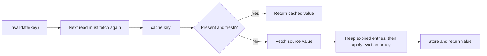
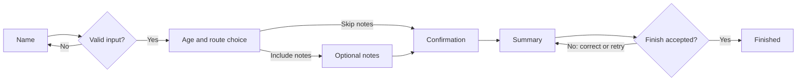
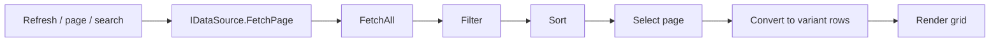

# PascalFramework

Delphi-mode utilities for Free Pascal and Lazarus: caches, wizards, disposal scopes,
events, collections, data rows and grids.

## Cache a value

Fetch on a miss, reuse on a hit, and expire entries after 30 seconds.

```pascal
program BasicCache;
{$mode Delphi}{$H+}

uses SysUtils, UCommon, UMemory, UCache;

type
  TStringCache = TActionCache<Integer, AnsiString>;

function Fetch(const AKey : Integer) : AnsiString;
begin
  Result := 'value ' + IntToStr(AKey);
end;

function Estimate(const AValue : AnsiString) : SizeInt;
begin
  Result := Length(AValue);
end;

var
  cache : TStringCache;
begin
  cache := TStringCache.Create(nil,
    TStringCache.TValueFetcher.FromGlobalFunction(Fetch),
    TStringCache.TSizeEstimator.FromGlobalFunction(Estimate),
    idpNone, TStringCache.TCacheReapPolicy.crpLeastUsed,
    TStringCache.TExpirationPolicy.epSinceFetchedTime,
    TStringCache.TNullValuePolicy.nvpCacheNormally,
    1024, TTimeSpan.FromSeconds(30));
  try
    WriteLn(cache[7]);              // Fetch.
    WriteLn(cache[7]);              // Hit.
    cache.Invalidate(7);
    WriteLn(cache[7]);              // Fetch again.
    cache[8] := 'supplied value';   // Store without fetching.
    cache.Get(8).CanPurge := false; // Pin against automatic eviction.
    cache.Remove(8);               // Explicit removal ignores the pin.
  finally
    cache.Free;
  end;
end.
```

The estimator defines capacity units: `Length` counts string bytes; returning `1`
counts entries. Use `epSinceLastAccessedTime` for sliding expiration.



Object caches use `idpFreeAndNil` to free admitted objects on removal or destruction.
A rejected explicit write leaves ownership with its caller. Returned metadata and
owned values are borrowed. See [more cache examples](examples/cache/README.md) for
object ownership, notifications, capacity and callback adapters.

## Build a wizard

Run the included showcase from an LCL application. The wizard owns its screens;
the caller owns the model.

```pascal
uses Classes, UWizardFeatureModel, UWizardFeatureDemo;

procedure ShowFeatureWizard(AOwner : TComponent);
var
  model : TWizardFeatureModel;
  wizard : TWizardFeatureDemo;
begin
  model := TWizardFeatureModel.Create;
  try
    model.IncludeOptional := true;
    model.FinishOutcome := fcoVetoOnce;
    wizard := TWizardFeatureDemo.Create(AOwner, model);
    try
      wizard.Start(model);
    finally
      wizard.Free;
    end;
    // Inspect model.Name, model.Age and model.Events here.
  finally
    model.Free;
  end;
end;
```

Open [FrameworkTester.lpi](examples/wizard/FrameworkTester.lpi) and choose
**Wizard feature showcase**; its search paths already include these demo units.



Actual native LCL screens from the showcase:

| Name and validation | Age and route editing |
| --- | --- |
|  |  |
| **Optional notes** | **Confirmation boundary** |
|  |  |
| **Completion and retry** | |
|  | [Walkthrough and launcher](examples/wizard/README.md) |

Derive screens from `TWizardForm<TModel>`. Adapt the demo's
[Name screen](examples/wizard/UWIZFeatureName.pas) for a minimal dynamic route as
below, adding these units to its implementation `uses` clause. `Model` is already
assigned when `Initialize` runs.

```pascal
uses UWizard, UWIZFeatureAge, UWIZFeatureCommit, UWIZFeatureSummary;

procedure TWIZFeatureName.Initialize;
begin
  Traits := [wstAssumeHasNext]; // This screen creates its successor later.
  inherited Initialize;
end;

function TWIZFeatureName.Validate(out message : AnsiString) : boolean;
begin
  message := '';
  if Trim(FNameEdit.Text) = '' then
    message := 'Enter a name before continuing'
  else if NOT FConfirmedCheckBox.Checked then
    message := 'Confirm the name before continuing';
  Result := message = '';
end;

procedure TWIZFeatureName.OnNext;
begin
  inherited OnNext;
  Model.Name := Trim(FNameEdit.Text);
  UpdatePath(ptInject, [TWIZFeatureAge, TWIZFeatureCommit, TWIZFeatureSummary]);
end;
```

Use `ptReplaceAllNext` to change the continuation, `ptReplaceAll` to replace the
route, or `ptRemoveNext` to remove future steps. Identical contiguous injections
are idempotent. A rejected finish/cancel stays active for retry; accepted completion
runs once. See the [wizard guide](examples/wizard/README.md) for callback signatures,
Back navigation and screen lifetimes.

## Dispose resources at scope exit

`UMemory.TDisposables` releases registered objects even when a procedure raises.

```pascal
uses Classes, UMemory;

procedure BuildReport;
var
  scope : TDisposables;
  lines : TStringList;
begin
  lines := scope.AddObject(TStringList.Create) as TStringList;
  lines.Add('Ready');
  // Use lines here. The scope frees it when this procedure exits.
end;
```

Call `scope.RemoveObject(lines)` before transferring ownership to a caller. Keep
the scope local and do not copy it.

## Work with arrays and collections

`UCommon.TArrayTool<T>` creates and edits arrays. Copies have independent array
storage; object elements still refer to the same objects.

```pascal
uses Generics.Collections, UCommon;

procedure ArrayExample;
var
  values, snapshot : TArray<Integer>;
begin
  values := TArrayTool<Integer>.Create(10, 20, 30);
  TArrayTool<Integer>.Append(values, 40);
  TArrayTool<Integer>.Remove(values, 20);
  snapshot := TArrayTool<Integer>.Copy(values); // 10, 30, 40.
end;
```

`UCommon.Collections` adapts predicates and comparers to the bundled generic
containers. `FilterBy` changes the supplied list.

```pascal
uses Generics.Collections, Generics.Defaults, UCommon, UCommon.Collections, UMemory;

function IsEven(constref AValue : Integer) : boolean;
begin
  Result := (AValue mod 2) = 0;
end;

function Descending(constref ALeft, ARight : Integer) : Integer;
begin
  Result := TCompare.Integer(ARight, ALeft);
end;

procedure FilterAndSort;
var
  scope : TDisposables;
  values : TList<Integer>;
begin
  values := scope.AddObject(TList<Integer>.Create) as TList<Integer>;
  values.AddRange([1, 2, 3, 4, 5, 6]);
  TListTool<Integer>.FilterBy(values, TPredicateTool<Integer>.FromFunc(IsEven));
  values.Sort(TComparerTool<Integer>.FromFunc(Descending)); // 6, 4, 2.
end;
```

Compose predicates with `AndMany`/`OrMany`, comparers with `Many`/`Inverted`, and
map values with `TListTool<TSource, TResult>.Transform`.

## Return values with diagnostics

`UCommon.TResult` carries a Variant value plus info, warning and error messages.

```pascal
uses UCommon;

function ValidateName(const AName : String) : TResult;
begin
  if AName = '' then
    Exit(TResult.Failure('Enter a name'));
  Result := TResult.Success('Name accepted');
  Result.Value := AName;
end;
```

## Use dates, bytes and running statistics

```pascal
uses SysUtils, UCommon;

procedure CommonExample;
var
  expires : TDateTime;
  bytes : TBytes;
  stats : TStatistics;
begin
  expires := TDateTime.Now.AddMinutes(5);
  bytes := Hex2Bytes('00FF');
  WriteLn(Bytes2Hex(bytes));                // 00FF.
  stats.Reset;
  stats.AddDatum(10);
  stats.AddDatum(20);
  stats.AddDatum(30);
  WriteLn(stats.Mean:0:1);                  // 20.0.
  WriteLn(TVariantTool.NumericGTE(21, 18));  // TRUE.
end;
```

`UCommon` also provides `TTimeSpan`, `TBox<T>`, `TFileTool.AppendText` and
`TCPUTool.GetLogicalCPUCount`. Browse their [declarations](src/Sphere10/UCommon.pas)
for the small supporting helpers.

## Notify several listeners

`UCommon.TNotifyManyEvent` stores object-method listeners.

```pascal
uses Classes, UCommon;

type
  TDocument = class
  private
    FChanged : TNotifyManyEvent;
    procedure HandleChanged(Sender : TObject);
  public
    procedure Demonstrate;
  end;

procedure TDocument.HandleChanged(Sender : TObject);
begin
  WriteLn('Document changed');
end;

procedure TDocument.Demonstrate;
begin
  FChanged.Add(HandleChanged);
  try
    FChanged.Invoke(Self);
  finally
    FChanged.Remove(HandleChanged);
  end;
end;
```

`Add(HandleChanged, True)` queues delivery on the main thread. Queued senders and
receivers must remain alive until delivery.

## Coalesce UI events

`UCommon.UI.TThrottledEvent` delivers a notification after a burst becomes idle.
Create an owned event, then call its `Notify` from UI event handlers.

```pascal
uses Classes, UCommon, UCommon.UI;

function CreateRefreshEvent(AOwner : TComponent;
  AHandler : TNotifyEvent) : TThrottledEvent;
begin
  Result := TThrottledEvent.Create(AOwner);
  Result.Interval := TTimeSpan.FromMilliseconds(250);
  Result.Mode := temNotifyOnEventBurstFinished;
  Result.Add(AHandler);
end;
```

An active LCL message loop is required. Other modes notify immediately, at
intervals, or at both the start and end of a burst.

## Keep resources with a form

`TApplicationForm.AutoDispose` owns noncomponent objects until form destruction.
Use component ownership for controls and `AddControlDockCenter` to fill a container.

```pascal
uses Classes, Controls, ExtCtrls, UCommon.UI;

procedure PrepareForm(AForm : TApplicationForm; AContainer : TWinControl);
var
  names : TStringList;
  panel : TPanel;
begin
  names := AForm.AutoDispose(TStringList.Create) as TStringList;
  names.Add('Ada');
  panel := TPanel.Create(AForm);
  panel.Caption := names[0];
  AContainer.AddControlDockCenter(panel);
end;
```

Application forms hide on Close by default; hidden forms still own their resources.

## Describe rows and parse searches

`UCommon.Data` exposes named fields through a managed Variant. Use one schema ID
for each consistent set of columns; field names are case-sensitive.

```pascal
uses SysUtils, Variants, UCommon.Data;

type
  TPersonSchema = class end;

procedure ShowPerson;
var
  columns : TDataColumns;
  row : Variant;
  expression : TExpressionRecord;
begin
  columns := TDataColumns.Create(
    TDataColumn.From('ID', true), TDataColumn.From('Name'));
  row := TDataRow.New(PtrInt(TPersonSchema), columns);
  row.ID := 7;
  row.Name := 'Ada';
  WriteLn(VarToStr(row.Name));
  expression := TSearchExpressionService.Parse('>=18');
  // ekNum, nckNumericGTE, Values[0] = '18'.
  expression := TSearchExpressionService.Parse('[10,20]'); // Inclusive interval.
  expression := TSearchExpressionService.Parse('Ada%');  // Text prefix.
end;
```

## Display a data source in a grid

Implement three methods; `TCustomDataSource<T>` supplies filtering, sorting,
paging and conversion to data rows.

```pascal
uses Classes, Variants, Generics.Collections, UCommon.Data;

type
  TNameSource = class(TCustomDataSource<AnsiString>)
  protected
    function GetColumns : TDataColumns; override;
    procedure FetchAll(const AContainer : TList<AnsiString>); override;
    function GetItemField(constref AItem : AnsiString;
      const ABindingName : AnsiString) : Variant; override;
  end;

function TNameSource.GetColumns : TDataColumns;
begin
  Result := TDataColumns.Create(TDataColumn.From('Name'));
end;

procedure TNameSource.FetchAll(const AContainer : TList<AnsiString>);
begin
  AContainer.Add('Ada');
  AContainer.Add('Grace');
end;

function TNameSource.GetItemField(constref AItem : AnsiString;
  const ABindingName : AnsiString) : Variant;
begin
  Result := AItem;
end;
```

Attach it to a `UVisualGrid.TVisualGrid` from your form:

```pascal
uses Forms, UCommon.Data, UCommon.UI, UVisualGrid;

procedure ShowNames(AForm : TForm);
var
  source : TNameSource;
  grid : TVisualGrid;
begin
  source := TNameSource.Create(AForm);
  grid := TVisualGrid.Create(AForm);
  grid.FetchDataInThread := false;
  grid.PageSize := 25;
  with grid.AddColumn('Name') do begin
    Binding := 'Name';
    Filters := SORTABLE_TEXT_FILTER;
  end;
  AForm.AddControlDockCenter(grid);
  grid.DataSource := source; // Fetch the first page.
end;
```



Call `grid.RefreshGrid` after changing source data. For worker fetching, set
`FetchDataInThread := true`, keep the grid/source alive until completion, and keep
source callbacks free of LCL access. See the [grid demo](examples/visualgrid/fMain.pas)
and [SQLite example](examples/visualgrid_sqlite/fMain.pas) for rendering and selection.

## Open, build and test

Open [Sphere10Framework.lpg](Sphere10Framework.lpg) in Lazarus, or select a project:

| Project | Purpose |
| --- | --- |
| [CacheExample.lpi](examples/cache/CacheExample.lpi) | Runnable cache examples |
| [FrameworkTester.lpi](examples/wizard/FrameworkTester.lpi) | Wizard, event and work-area demos |
| [VisualGridExample.lpi](examples/visualgrid/VisualGridExample.lpi) | Grid demo |
| [FrameworkTests.lpi](tests/FrameworkTests.lpi) | FPCUnit GUI runner |
| [Sphere10Framework.lpk](packages/Sphere10Framework.lpk) | Reusable library/control package |

Use Delphi mode and add `src/Sphere10` and `src/Generics.Collections` to the unit
search path. UI units require Lazarus LCL; the supplied projects configure their
paths. Package installation is optional; see the [package guide](packages/README.md).

Run the unit suite and the real modal wizard check on Windows:

```powershell
.\tests\RunTests.ps1 `
  -FpcPath 'D:\Pascal\fpc\bin\x86_64-win64\fpc.exe' `
  -LazarusDirectory 'D:\Pascal\lazarus'

.\tests\RunWizardNativeTests.ps1 `
  -FpcPath 'D:\Pascal\fpc\bin\x86_64-win64\fpc.exe' `
  -LazarusDirectory 'D:\Pascal\lazarus'
```

Replace the tool paths for your installation. The native probe checks one stable
wizard window, hidden inactive screens and retry/cancel behavior on a private
desktop. See the [test guide](tests/README.md) for coverage and fixture selection.

## License

[MIT](LICENSE). Copyright Herman Schoenfeld; third-party notices are retained in
their source directories.
