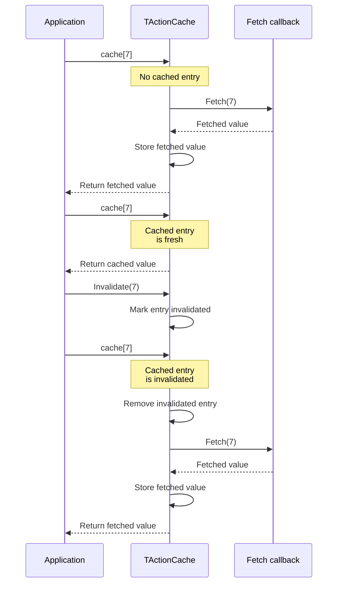
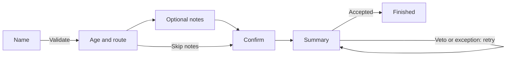
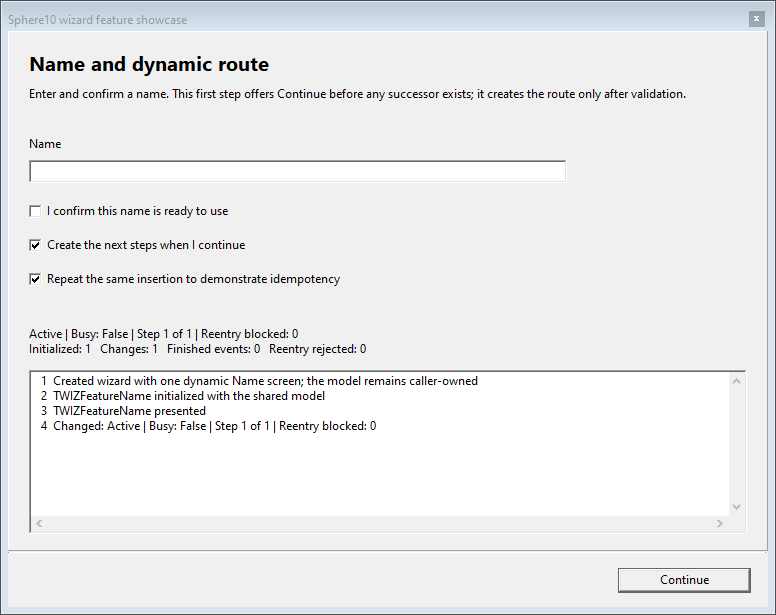
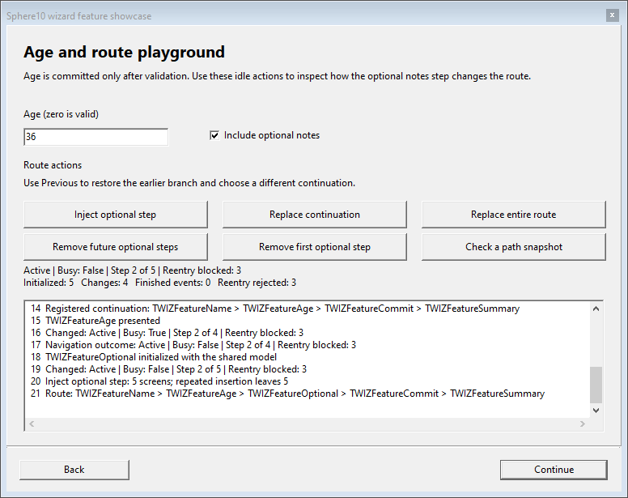
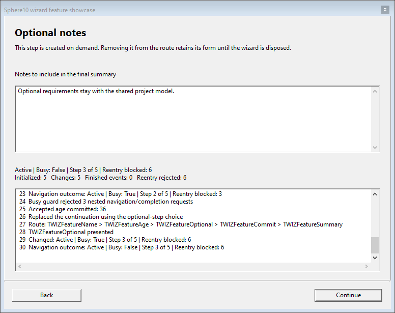
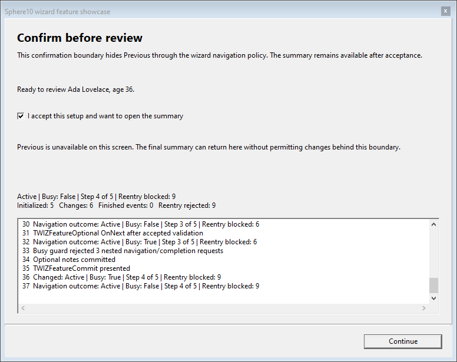
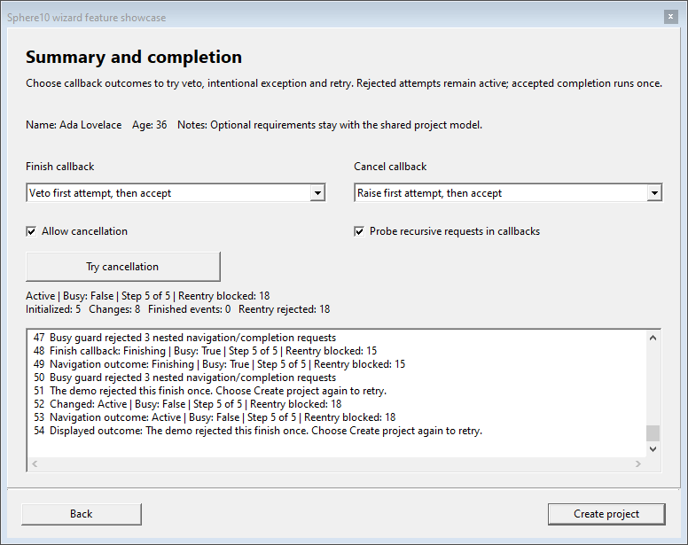

<p align="center">
  <a href="https://sphere10.com/"></a>
</p>

[](https://github.com/HermanSchoenfeld/PascalFramework/actions/workflows/main.yml)
[](packages/README.md#delphi-13)
[](tests/README.md)
[](tests/README.md)
[](tests/README.md)
[](tests/README.md)
[](LICENSE)

# Sphere 10 Pascal Framework

Sphere 10 Pascal Framework is [Sphere10's](https://sphere10.com/) reusable Object Pascal
library for **Lazarus/Free Pascal (LCL) and Delphi (VCL)**. It provides data-bound visual grids, multi-step wizards
and configurable caches, together with the supporting utilities applications
need: scoped resource cleanup, generic collection helpers, data sources,
multicast events, date/time helpers and UI event throttling.

The components work together: visual grids consume data sources that handle
filtering, sorting and paging; wizard screens share a typed model and can change
their route at runtime; caches control how values are fetched, retained and
released. Use the units directly in a project or add the optional
[Lazarus or Delphi package](packages/README.md). The examples below show their individual
APIs. Open [Sphere10PascalFramework.dproj](Sphere10PascalFramework.dproj) in Delphi or
[Sphere10PascalFramework.lpi](Sphere10PascalFramework.lpi) in Lazarus to run one application with
Visual grid, Wizard/events, Cache, Refresh throttle and Utilities sections. Both projects use the same
[entry point](Sphere10PascalFramework.dpr) and [demo sources](examples/demo/README.md).

The supplied projects target **Delphi 13 Community Edition**, **Lazarus 2.1 /
Free Pascal 3.2.0** and **Lazarus 4.8 / Free Pascal 3.2.2** on Windows. Delphi
uses VCL; Lazarus uses LCL's Win32 widgetset, including for Win64 applications.
See [build instructions](#open-build-and-test) and the [test guide](tests/README.md)
for the compiler-specific commands and verification scope. The [CI workflow](.github/CI.md)
builds the Lazarus package and demo and runs FPCUnit; its badge reports hosted
GitHub results separately from local Delphi and Lazarus checks.


## Units

| Unit | Description |
| --- | --- |
| [UVisualGrid.pas](src/Sphere10/UVisualGrid.pas) | Data-bound LCL/VCL grid with paging and automatic page sizes, text/numeric filters, single/multi-column sorting, cell/row/multi-row selection, custom rendering, popup menus, optional background fetching, an owned refresh throttle, cooperative refresh suspension and a customizable loading card with input control. |
| [UCache.pas](src/Sphere10/UCache.pas) | Generic caches with fetch callbacks, explicit/bulk writes, whole-source and preloaded snapshots, invalidation, fixed/sliding expiration, capacity and eviction policies, entry pins, staleness checks, null-value policies, lifecycle events and disposal policies. |
| [UWizard.pas](src/Sphere10/UWizard.pas) | Typed-model wizard screens in one host window, with validation, Back/Continue navigation, dynamic route insertion/replacement/removal, finish/cancel vetoes, retryable completion and lifecycle notifications. |
| [UMemory.pas](src/Sphere10/UMemory.pas) | Scope-owned cleanup of objects and allocated memory through `TDisposables`, allocation/reallocation helpers, explicit ownership transfer and shared disposal-policy definitions. |
| [UCommon.pas](src/Sphere10/UCommon.pas) | Shared helpers for arrays, Variants, date/time arithmetic, durations, bytes/hex, statistics, result diagnostics, multicast events, thread-targeted notifications, files and CPU information. |
| [UCommon.Collections.pas](src/Sphere10/UCommon.Collections.pas) | Composable predicates/comparers and transformation adapters for global functions, object methods and nested callbacks, plus list filtering, removal, slicing and transformation helpers. |
| [UCommon.Data.pas](src/Sphere10/UCommon.Data.pas) | Named Variant rows and column schemas, text/numeric search expressions, filter/sort criteria and generic data sources with filtering, sorting, paging and opt-in invalidatable snapshots. |
| [UCommon.UI.pas](src/Sphere10/UCommon.UI.pas) | Application forms with lifecycle events and owned-object cleanup, the TLoadingCircle visual indicator, control docking and image helpers, and throttled/coalesced UI notifications. |
| [UConcurrency.pas](src/Sphere10/UConcurrency.pas) | Shared-memory synchronization with concurrent readers, one exclusive writer, upgradeable reads, optional recursion, timed acquisition and thread ownership checks. |

The bundled [Generics.Collections](src/Generics.Collections/generics.collections.pas)
library supplies the Free Pascal lists, dictionaries, queues, stacks and sets;
Delphi uses its native RTL generics. UI components select Lazarus LCL or Delphi
VCL through compiler conditionals. The supplied projects configure those paths.

# Example uses:

## Visual grid

[TVisualGrid](src/Sphere10/UVisualGrid.pas) combines [paging and automatic page sizes](src/Sphere10/UVisualGrid.pas),
[single-expression or per-column search](src/Sphere10/UVisualGrid.pas),
[single/multi-column sorting](src/Sphere10/UVisualGrid.pas) and
[cell, row or multiple-row selection](src/Sphere10/UVisualGrid.pas). Configure column
widths/stretching, fonts/alignment, custom cell renderers, selection callbacks,
popup menus and extra toolbar controls through the same [grid unit](src/Sphere10/UVisualGrid.pas).


The native Lazarus capture shows eight columns, a generated 10,000-record source,
a live property editor and an automatic page size of 28 complete rows. The Real
column uses the [DollarValue renderer](src/Sphere10/UVisualGrid.pas). The same
application contains the wizard, cache, throttle and utility demonstrations.

Implement three methods in [TCustomDataSource<T>](src/Sphere10/UCommon.Data.pas);
it supplies filtering, sorting, paging and conversion to named Variant rows.

```pascal
uses Classes, Variants, Generics.Collections, UCommon.Data;

type
  TNameSource = class(TCustomDataSource<String>)
  protected
    function GetColumns : TDataColumns; override;
    procedure FetchAll(const AContainer : TList<String>); override;
    function GetItemField({$IFDEF FPC}constref{$ELSE}const{$ENDIF} AItem : String;
      const ABindingName : String) : Variant; override;
  end;

function TNameSource.GetColumns : TDataColumns;
begin
  Result := TDataColumns.Create(TDataColumn.From('Name'));
end;

procedure TNameSource.FetchAll(const AContainer : TList<String>);
begin
  AContainer.Add('Ada');
  AContainer.Add('Grace');
end;

function TNameSource.GetItemField({$IFDEF FPC}constref{$ELSE}const{$ENDIF} AItem : String;
  const ABindingName : String) : Variant;
begin
  Result := AItem;
end;
```

Attach it to [TVisualGrid](src/Sphere10/UVisualGrid.pas) from your form:

```pascal
uses Forms, UCommon.Data, UCommon.UI, UVisualGrid;

procedure ShowNames(AForm : TForm);
var
  source : TNameSource;
  grid : TVisualGrid;
begin
  source := TNameSource.Create(AForm);
  source.SnapshotCacheEnabled := true;
  grid := TVisualGrid.Create(AForm);
  grid.FetchDataInThread := false;
  grid.PageSize := 25;
  with grid.AddColumn('Name') do begin
    Binding := 'Name';
    Filters := SORTABLE_TEXT_FILTER;
  end;
  AForm.AddControlDockCenter(grid);
  grid.DataSource := source; // Fetch the first page.
end;
```


Each grid owns a [RefreshThrottle](src/Sphere10/UVisualGrid.pas), whose default
`temNone` mode keeps immediate refresh behavior. Enable five-second leading and
trailing admission before assigning `DataSource`. Here `FGrid` is an existing
form field of type `TVisualGrid`:

```pascal
uses UCommon, UCommon.UI, UVisualGrid;

procedure TMyForm.ConfigureGridRefresh;
begin
  FGrid.RefreshThrottle.Interval := TTimeSpan.FromSeconds(5);
  FGrid.RefreshThrottle.Mode :=
    TThrottledEvent.TThrottledEventMode.temNotifyOnEventBurstStartAndFinished;
  FGrid.RefreshThrottle.OnWaitingChanged.Add(GridWaitingChanged);
end;

procedure TMyForm.GridWaitingChanged(Sender : TObject);
begin
  if FGrid.RefreshSuspended then Exit; // Preserve an application-owned hold card.
  if FGrid.RefreshThrottle.Waiting then
    FGrid.ShowLoading('Please Wait', 'Synchronizing')
  else
    FGrid.HideLoading;
end;
```

The first request can fetch immediately. Every later client request, including
paging, filtering, sorting, source replacement and resizing, restarts that grid's
quiet timer and retains the latest parameters. While waiting, resizing changes
layout without fetching. After five quiet seconds, one pending request is admitted
with the latest parameters; if its own older fetch is still active, it waits for
that worker to complete. This replay does not restart Waiting. A single input gets
no duplicate ordinary delivery. Internal result layout and worker replay do not
create new inputs. A user completion
handler that calls `RefreshGrid` does create a new input. Each grid is independent:
node/network state and another grid's worker cannot extend its `Waiting` state.
Call this configuration and state handler on the UI thread; remove the listener
before destroying a listener that has a shorter lifetime than the grid.

Use `RefreshSuspended` when application policy must temporarily prevent provider
queries independently of the throttle. Visual layout and refresh requests still
retain the latest parameters. Suspension requests cooperative cancellation of an
active worker without joining it; its obsolete result or error is discarded.
Providers should check their worker's termination flag while doing lengthy work.
For example, an application can pause a view during a background import:

```pascal
procedure TMyForm.ImportStarted;
begin
  FGrid.RefreshSuspended := True;
  FGrid.ShowLoading('Please Wait', 'Importing');
end;

procedure TMyForm.ImportFinished;
begin
  FGrid.HideLoading;
  FGrid.RefreshThrottle.Cancel; // Cancel while suspended: no early query.
  FGrid.RefreshSuspended := False; // Resume one latest retained request.
end;
```

Call these methods on the UI thread. Resuming normally respects any remaining
throttle wait; the explicit cancellation above admits the latest page immediately,
once a canceled older worker has retired. Suspension contains no application,
node or networking dependency and does not change the throttle's timer contract.

Call [RefreshGrid](src/Sphere10/UVisualGrid.pas) after changing source data. For worker fetching, set
`FetchDataInThread := true`, keep the grid/source alive until completion, and keep
source callbacks free of LCL/VCL control access. Publish UI state through the
grid's completion event on the main thread. The worker queues completion directly;
the grid does not poll for a finished fetch. Its owned dispatcher retires the
worker, publishes the page once and discards queued callbacks safely on disposal.
See the [unified grid demo](examples/demo/fMain.pas) for rendering and selection.
The preserved [SQLite adapter recipe](examples/demo/sqlite/fMain.pas) is reference
source for the older optional mORMot integration, with no separate application target.

Enable [SnapshotCacheEnabled](src/Sphere10/UCommon.Data.pas) when the data source
can retain a stable dataset between updates. It keeps one raw snapshot and one
current filtered/sorted view, so changing pages converts only the visible rows;
changing search or sort reuses the raw snapshot. Caching is off by default.
After changing the backing data, invalidate the snapshot before refreshing:

```pascal
procedure RefreshNames(ASource : TNameSource; AGrid : TVisualGrid);
begin
  ASource.InvalidateSnapshot;
  AGrid.RefreshGrid;
end;
```

[InvalidateSnapshot](src/Sphere10/UCommon.Data.pas) marks the next fetch for
rebuilding without waiting for an active fetch. An in-flight fetch can finish its
previous snapshot. Object items remain borrowed: keep them alive while cached
snapshots are reused and while fetches are active.

The default [FetchPage](src/Sphere10/UCommon.Data.pas) still loads the initial raw
dataset through `FetchAll`; caching makes subsequent pages cheaper, not that
initial load. Sources with indexed or database-native paging can override the
virtual method to retrieve only their requested records and return accurate
counts/page bounds. Arbitrary filtering and sorting must still apply to the
complete selected query before choosing its page.

Outstanding grid refreshes retain the previous rows and show a compact bordered
loading card after 200 ms, including requests waiting for the refresh throttle.
The card uses [TLoadingCircle](src/Sphere10/UCommon.UI.pas), stays visible
through fetch admission and disappears after completion or cancellation; quick
cached pages avoid flashing it.

Use [ShowLoading / HideLoading](src/Sphere10/UVisualGrid.pas) to hold a card while
waiting for external work, independently of a page fetch. Supply a title,
optional subtitle and optional `TGraphic`; the grid copies the graphic so its
caller retains ownership. Omitting the image uses the loading circle.

```pascal
grid.ShowLoading('Please Wait', 'Importing records', MyLoadingImage);
// Grid, search and paging input are disabled; completed rows remain visible.
// Programmatic refreshes can still publish replacement pages.
grid.RefreshGrid;
// Call when the external work and required page publication have finished:
grid.HideLoading;
```

The optional fourth parameter, `ADisableInput`, defaults to `true`. Pass `false`
for a card that permits interaction. `LoadingVisible` reports this held state;
`IsUpdating` continues to report only an asynchronous page fetch. Fetch completion
cannot dismiss a held card. `HideLoading` restores the current fetch/error
presentation and its input restrictions without changing the grid's `Enabled`
property. Call these UI methods on the main thread.

## Loading circle

[TLoadingCircle](src/Sphere10/UCommon.UI.pas) displays an animated loading
indicator. Set `Active` on the UI thread while work runs; freeing the control
stops its owned animation timer. The same control supports LCL and VCL.

```pascal
uses Classes, Controls, UCommon.UI;

function AddLoadingCircle(AOwner : TComponent; AParent : TWinControl) : TLoadingCircle;
begin
  Result := TLoadingCircle.Create(AOwner);
  Result.Parent := AParent;
  Result.SetBounds(12, 12, 36, 36);
  Result.Active := true;
  // Set Result.Active := false when the operation finishes.
end;
```

The port retains Martin R. Gagné's original copyright and license in the
[unit source](src/Sphere10/UCommon.UI.pas).

## Caching

[TActionCache<TKey, TValue>](src/Sphere10/UCache.pas) memoizes fetches, accepts explicit
writes and supports invalidation. Configure [fixed or sliding expiration](src/Sphere10/UCache.pas),
[least-used, largest, smallest, oldest, idle, ASAP or no-policy eviction](src/Sphere10/UCache.pas),
[pinned entries](src/Sphere10/UCache.pas) and [on-demand staleness checks](src/Sphere10/UCache.pas).
[Null handling](src/Sphere10/UCache.pas) can cache nil, return it without caching,
or reject it; [fetch/removal events](src/Sphere10/UCache.pas) report each lifecycle
phase. [Typed callback adapters](src/Sphere10/UCache.pas) accept global functions,
object methods and nested functions.
Subclasses supply [CheckStaleness](src/Sphere10/UCache.pas) for application-specific
stale checks.

```pascal
program BasicCache;
{$IFDEF FPC}{$mode Delphi}{$H+}{$ENDIF}

uses SysUtils, UCommon, UMemory, UCache;

type
  TStringCache = TActionCache<Integer, String>;

function Fetch(const AKey : Integer) : String;
begin
  Result := 'value ' + IntToStr(AKey);
end;

function Estimate(const AValue : String) : SizeInt;
begin
  Result := Length(AValue) * SizeOf(Char);
end;

var
  cache : TStringCache;
begin
  cache := TStringCache.Create(nil,
    TStringCache.TValueFetcher.FromGlobalFunction(Fetch),
    TStringCache.TSizeEstimator.FromGlobalFunction(Estimate),
    idpNone, TStringCache.TCacheReapPolicy.crpLeastUsed,
    TStringCache.TExpirationPolicy.epSinceFetchedTime,
    TStringCache.TNullValuePolicy.nvpCacheNormally,
    1024, TTimeSpan.FromSeconds(30));
  try
    WriteLn(cache[7]);              // Fetch.
    WriteLn(cache[7]);              // Hit.
    cache.Invalidate(7);
    WriteLn(cache[7]);              // Fetch again.
    cache[8] := 'supplied value';   // Store without fetching.
    cache.Get(8).CanPurge := false; // Pin against automatic eviction.
    cache.Remove(8);               // Explicit removal ignores the pin.
  finally
    cache.Free;
  end;
end.
```

The [size estimator](src/Sphere10/UCache.pas) defines capacity units. The example
uses `Length(AValue) * SizeOf(Char)` to count native string payload bytes;
returning `1` instead counts entries. This excludes object/string allocation
overhead. Use `epSinceLastAccessedTime` for sliding expiration.

Cache operations and callbacks use a recursive lock. Callbacks may access the
same cache again, but must not destroy it. `Get` exposes a borrowed entry; keep
entries and object values alive while using them outside an operation. The value
indexer copies its result while the lock is held.



Object caches use [idpFreeAndNil](src/Sphere10/UMemory.pas) to free admitted objects on removal or destruction.
A rejected explicit write leaves ownership with its caller. Returned metadata and
owned values are borrowed. See [more cache examples](examples/demo/README.md) for
object ownership, notifications, capacity and callback adapters.

## Whole-source cache snapshots

[TBulkFetchActionCache<TKey,TValue>](src/Sphere10/UCache.pas) loads a complete dictionary in one provider call. Its first read, `ContainsCachedItem` or `GetAllCachedValues` loads that snapshot. Ordinary missing, expired or stale reads refresh the source at most once per request. With `FetchOnceOnly = True`, reads retain loaded values despite expiry or invalidation. `ForceRefresh` replaces the snapshot; `Purge` clears it for a later reload. Bulk `Reap` validates its arguments and returns zero without evicting snapshot entries.

```pascal
uses Classes, SysUtils, Generics.Collections, UCommon, UMemory, UCache;

type
  TCatalogue = TBulkFetchActionCache<Integer,String>;
  TCatalogueBase = TCacheBase<Integer,String>;

procedure FetchCatalogue(AValues: TCatalogue.TBulkValues);
begin
  // Replace these entries with one database/query result for the whole catalogue.
  AValues.Add(1,'apple');
  AValues.Add(2,'pear');
end;

procedure ShowCatalogue(AOutput: TStrings);
var
  resources: TDisposables;
  cache: TCatalogue;
  snapshot: TArray<String>;
begin
  cache := TCatalogue(resources.AddObject(TCatalogue.Create(nil,
    TCatalogue.TBulkValueFetcher.FromGlobalFunction(FetchCatalogue),
    TCatalogueBase.TExpirationPolicy.epNone,TTimeSpan.MaxValue,True)));
  AOutput.Add(cache[1]);                 // One provider call loads keys 1 and 2.
  AOutput.Add(cache[2]);                 // Uses the already loaded snapshot.
  cache.Invalidate(1);
  AOutput.Add(cache[1]);                 // Fetch-once retains the original value.
  cache.ForceRefresh;                   // Purge first, then fetch the whole source.
  snapshot := cache.GetAllCachedValues; // A copied array of the current values.
  AOutput.Add(IntToStr(Length(snapshot)));
end; // resources frees the cache automatically.
```

The provider fills a temporary dictionary owned by the cache and must not retain that container. Object/pointer payloads are borrowed, so their owner must keep them alive while the cache or returned values use them. `ForceRefresh` purges before fetching: provider failure propagates and leaves the old snapshot unavailable; the next read can retry. Individual `Remove` is unsupported. `GetAllCachedValues` materializes an array without a per-key fetch; ordinary caches only return current entries, while bulk caches first load an uninitialized snapshot. Object values in that array remain borrowed.

[TPreloadedCache<TKey,TValue>](src/Sphere10/UCache.pas) borrows an existing dictionary and reads it into a fetch-once snapshot. Keep that original dictionary and its payloads alive until the cache is freed; `ForceRefresh` sees later edits.

```pascal
type
  TCatalogueValues = TDictionary<Integer,String>;
  TPreloadedCatalogue = TPreloadedCache<Integer,String>;

procedure ShowPreloaded(AOutput: TStrings);
var
  resources: TDisposables;
  source: TCatalogueValues;
  cache: TPreloadedCatalogue;
begin
  source := TCatalogueValues(resources.AddObject(TCatalogueValues.Create));
  source.Add(1,'apple');
  cache := TPreloadedCatalogue(resources.AddObject(
    TPreloadedCatalogue.Create(nil,source)));
  AOutput.Add(cache[1]);   // apple
  source[1] := 'apricot';
  AOutput.Add(cache[1]);   // apple: existing snapshot
  cache.ForceRefresh;
  AOutput.Add(cache[1]);   // apricot: refreshed source
end; // reverse registration order frees cache before source.
```

The [complete executable examples](examples/demo/UCacheApiExamples.pas) cover ordinary global/object/nested callbacks, interface wrappers, typed notifications, a cache subclass with stale detection, entry metadata, explicit `BulkLoad`, whole-source snapshots and preloaded dictionaries. `BulkLoad` remains sequential explicit admission: duplicate keys use the last value, a later failure keeps earlier successful writes, and no provider is called.
## Wizards

[TWizard<T> and TWizardForm<T>](src/Sphere10/UWizard.pas) host model-bound screens in
one modal window, with validation, Back/Next navigation, dynamic branches and
retryable finish/cancel vetoes. [Lifecycle events and busy-state guards](src/Sphere10/UWizard.pas)
report changes and reject reentry. The wizard owns its screens; the caller owns
the model. Run the included showcase from a Lazarus LCL or Delphi VCL application.

```pascal
uses Classes, UWizardFeatureModel, UWizardFeatureDemo;

procedure ShowFeatureWizard(AOwner : TComponent);
var
  model : TWizardFeatureModel;
  wizard : TWizardFeatureDemo;
begin
  model := TWizardFeatureModel.Create;
  try
    model.IncludeOptional := true;
    model.FinishOutcome := fcoVetoOnce;
    wizard := TWizardFeatureDemo.Create(AOwner, model);
    try
      wizard.Start(model);
    finally
      wizard.Free;
    end;
    // Inspect model.Name, model.Age and model.Events here.
  finally
    model.Free;
  end;
end;
```

Open [Sphere10PascalFramework.lpi](Sphere10PascalFramework.lpi) in Lazarus or
[Sphere10PascalFramework.dproj](Sphere10PascalFramework.dproj) in Delphi, select **Wizard and events**
and choose **Wizard feature showcase**. Both projects include these demo units.



Actual native LCL screens from the showcase:

| Name and validation | Age and route editing |
| --- | --- |
|  |  |
| **Optional notes** | **Confirmation boundary** |
|  |  |
| **Completion and retry** | |
|  | [Walkthrough and launcher](examples/demo/README.md) |

Derive screens from `TWizardForm<TModel>`. Adapt the demo's
[Name screen](examples/demo/UWIZFeatureName.pas) for a minimal dynamic route as
below, adding these units to its implementation `uses` clause. `Model` is already
assigned when `Initialize` runs.

```pascal
uses UWizard, UWIZFeatureAge, UWIZFeatureCommit, UWIZFeatureSummary;

procedure TWIZFeatureName.Initialize;
begin
  Traits := [wstAssumeHasNext]; // This screen creates its successor later.
  inherited Initialize;
end;

function TWIZFeatureName.Validate(out message : String) : boolean;
begin
  message := '';
  if Trim(FNameEdit.Text) = '' then
    message := 'Enter a name before continuing'
  else if NOT FConfirmedCheckBox.Checked then
    message := 'Confirm the name before continuing';
  Result := message = '';
end;

procedure TWIZFeatureName.OnNext;
begin
  inherited OnNext;
  Model.Name := Trim(FNameEdit.Text);
  UpdatePath(ptInject, [TWIZFeatureAge, TWIZFeatureCommit, TWIZFeatureSummary]);
end;
```

Use [ptReplaceAllNext, ptReplaceAll and ptRemoveNext](src/Sphere10/UWizard.pas)
to replace the continuation, replace the full route or remove future steps. Identical contiguous injections
are idempotent. A rejected finish/cancel stays active for retry; accepted completion
runs once. See the [wizard guide](examples/demo/README.md) for callback signatures,
Back navigation and screen lifetimes.

## Scoped disposal

[TDisposables](src/Sphere10/UMemory.pas) owns several objects and memory blocks
through one record. It releases them in reverse registration order when the
record's scope ends, including when a procedure raises an exception.

```pascal
uses Classes, UMemory;

function BuildLocalReport : String;
var
  scope : TDisposables;
  lines : TStringList;
  text : TStringStream;
  output : TMemoryStream;
  scratch : Pointer;
begin
  lines := scope.AddObject(TStringList.Create) as TStringList;
  text := scope.AddObject(TStringStream.Create('Report: ')) as TStringStream;
  output := scope.AddObject(TMemoryStream.Create) as TMemoryStream;
  scope.GetMem(scratch, 256);
  scope.ReallocMem(scratch, 512);
  FillChar(scratch^, 512, 0);
  lines.Add('Ready');
  text.Position := text.Size;
  text.WriteString(lines.Text);
  output.CopyFrom(text, 0);
  Result := text.DataString;
  // Reverse cleanup: scratch, output, text, lines.
end;
```

Keep the bag in a class field when resources should live as long as their owner:

```pascal
type
  TReportBuilder = class
  private
    FResources : TDisposables;
    FLines : TStringList;
    FText : TStringStream;
    FOutput : TMemoryStream;
  public
    constructor Create;
    function Build : String;
  end;

constructor TReportBuilder.Create;
begin
  inherited Create;
  FLines := FResources.AddObject(TStringList.Create) as TStringList;
  FText := FResources.AddObject(TStringStream.Create('')) as TStringStream;
  FOutput := FResources.AddObject(TMemoryStream.Create) as TMemoryStream;
end;

function TReportBuilder.Build : String;
begin
  FLines.Clear;
  FText.Size := 0;
  FOutput.Size := 0;
  FLines.Add('Ready');
  FText.WriteString(FLines.Text);
  FOutput.CopyFrom(FText, 0);
  Result := FText.DataString;
end;

function BuildClassReport : String;
var
  report : TReportBuilder;
begin
  report := TReportBuilder.Create;
  try
    Result := report.Build;
  finally
    report.Free; // Finalizes FResources and frees its three objects.
  end;
end;
```

`TReportBuilder` needs no destructor solely for those three resources. The
compiler finalizes its managed `FResources` field when the owner is freed; a
failed constructor also releases resources already registered. If a destructor
must perform additional shutdown work using those resources, do that work before
`inherited Destroy`; leave their final release to the bag. Register each object
once, and keep component-owned objects with their existing component owner.

Transfer ownership explicitly when a resource must outlive its bag:

```pascal
function CreateReadyLines : TStringList;
var
  scope : TDisposables;
begin
  Result := scope.AddObject(TStringList.Create) as TStringList;
  Result.Add('Ready');
  scope.RemoveObject(Result); // Caller now owns the returned object.
end;

function CreateOwnedBuffer : Pointer;
var
  scope : TDisposables;
begin
  scope.GetMem(Result, 256);
  FillChar(Result^, 256, 0);
  scope.RemoveMem(Result); // Caller must eventually call System.FreeMem.
end;
```

Use `AddMem` to adopt an existing `System.GetMem` allocation; use the bag's
`FreeMem` to release a registered allocation early. `Objects[...]` is the default
property form of `AddObject`, for example
`lines := scope[TStringList.Create] as TStringList`. Keep a bag in its original
local variable or class field: do not copy the record or free its registered
objects manually.

[TDisposePolicy](src/Sphere10/UMemory.pas) is the shared cleanup-policy enum.
`AddObject` selects `idpFree`, and `AddMem`/`GetMem` select `idpFreeMem`.
Consumers such as object caches also accept `idpNone`, `idpNil` and
`idpFreeAndNil`; a cleared stored pointer does not clear a caller's separate
variable. `idpRelease` is declared, but `TDisposables` does not implement interface
release through that policy. For reference-counted interfaces, retain an ordinary
interface variable and let the compiler release it.

## Arrays and collections

[TArrayTool<T>](src/Sphere10/UCommon.pas) searches and edits dynamic arrays.
[UCommon.Collections](src/Sphere10/UCommon.Collections.pas) adds list slicing,
filtering, sorting and transformations with reusable callbacks.
### Array construction, searching, editing and copying

`TArrayTool<T>` supplies all sixteen operations shown below. Arrays use zero-based
indexes. `Remove` removes every matching element. `InsertAt` inserts before an
existing index; use `Append` to add at the end. `Copy` allocates independent array
storage but object references still refer to the same objects. Pass the exact
number of enumerable elements to `ToArray`.

| Operation | Example/result |
| --- | --- |
| `Empty`, `Create` | Empty array or overloads with one through six values. |
| `Contains` | Boolean membership, optionally returning the index and accepting an equality comparer. |
| `IndexOf` | Index of a match, or `-1`; default or supplied equality comparer. |
| `Add`, `Append`, `Prepend`, `InsertAt` | Grow and insert values. |
| `Remove`, `RemoveAt` | Remove all equal values, or one indexed value. |
| `Swap`, `MoveItem` | Exchange positions, or move one item while preserving the others' order. |
| `Copy`, `Concat` | Copy a whole array/slice, or combine arrays. |
| `_Length`, `ToArray` | Open-array length, or materialize an enumerable of known size. |

### Comparers, predicates and transformations

The normal entry points are `TComparerTool<T>`, `TPredicateTool<T>`,
`TListTool<T>` and `TListTool<TSource,TResult>`. They adapt global functions,
object methods and nested callbacks, compose comparisons/predicates, filter lists
and transform either lists or arrays. Interface variables own their adapters;
the object supplying an object-method callback must outlive every use.

The complete example below also constructs every public adapter class directly:
`TNestedComparer`, `TObjectComparer`, `TGlobalComparer`, `TManyComparer`,
`TInvertedComparer`; `TNestedPredicate`, `TObjectPredicate`, `TGlobalPredicate`,
`TNotPredicate`, `TAndManyPredicate`, `TOrManyPredicate`; and
`TNestedTransformer`, `TObjectTransformer`, `TGlobalTransformer`. These are public
for compiler compatibility; the factories are usually simpler for application code.

`TListTool.Copy` takes a start index and a **count**, returning a caller-owned new
list. `Range`, `Skip` and `Take` mutate the supplied list and return the signed
size change (`new count - old count`). Filtering normally keeps object ownership
with the caller; supply `idpFreeAndNil` only for rejected objects this list owns.
The public spelling of the explicit slot-policy method is `DiposeItem`.

`TSortedHashSetTool<T>.Pop` is available only with FPC. It removes and returns
one enumerated value, and rejects an empty set. It is intentionally guarded in
the shared example because Delphi uses its RTL collection types.

<details>
<summary>Complete checked example: every array operation and every collection adapter type</summary>

```pascal
program ArrayCollectionExamples;
{$IFDEF FPC}{$mode Delphi}{$H+}{$modeswitch nestedprocvars}{$ENDIF}
uses Classes, SysUtils, Generics.Collections, Generics.Defaults,
  UCommon, UCommon.Collections, UMemory;

type
  TIntArrays = TArrayTool<Integer>;
  TIntComparerArrays = TArrayTool<IComparer<Integer>>;
  TIntPredicateArrays = TArrayTool<IPredicate<Integer>>;
  TIntComparerTools = TComparerTool<Integer>;
  TIntPredicateTools = TPredicateTool<Integer>;
  TIntListTools = TListTool<Integer>;
  TIntTextTransforms = TListTool<Integer,String>;
  {$IFDEF FPC}TIntSetTools = TSortedHashSetTool<Integer>;{$ENDIF}

procedure Require(ACondition: Boolean; const AMessage: String);
begin
  if not ACondition then raise Exception.Create(AMessage);
end;

procedure RequireArray(const AActual: TArray<Integer>; const AExpected: array of Integer);
var I: Integer;
begin
  Require(Length(AActual)=Length(AExpected),'Array length');
  for I:=0 to High(AActual) do Require(AActual[I]=AExpected[I],'Array value');
end;

procedure ArrayMethods;
var
  values, snapshot, middle, combined: TArray<Integer>;
  equality: IEqualityComparer<Integer>;
  index: SizeInt;
  scope: TDisposables;
  list: TList<Integer>;
begin
  values := TIntArrays.Empty;
  Require(Length(values)=0,'Empty');
  // Create has overloads for one through six values.
  values := TIntArrays.Create(10);
  RequireArray(values,[10]);
  values := TIntArrays.Create(10,20);
  RequireArray(values,[10,20]);
  values := TIntArrays.Create(10,20,30);
  RequireArray(values,[10,20,30]);
  values := TIntArrays.Create(10,20,30,40);
  RequireArray(values,[10,20,30,40]);
  values := TIntArrays.Create(10,20,30,40,50);
  RequireArray(values,[10,20,30,40,50]);
  values := TIntArrays.Create(10,20,30,40,50,60);
  RequireArray(values,[10,20,30,40,50,60]);

  values := TIntArrays.Create(10,20,30);
  TIntArrays.Add(values,40);               // 10,20,30,40
  TIntArrays.Append(values,50);            // 10,20,30,40,50
  TIntArrays.Prepend(values,0);            // 0,10,20,30,40,50
  TIntArrays.InsertAt(values,2,15);         // 0,10,15,20,30,40,50
  TIntArrays.Swap(values,0,6);             // 50,10,15,20,30,40,0
  TIntArrays.MoveItem(values,6,0);         // 0,50,10,15,20,30,40
  TIntArrays.Remove(values,20);            // 0,50,10,15,30,40
  equality := TEqualityComparer<Integer>.Default;
  TIntArrays.Remove(values,50,equality);   // 0,10,15,30,40
  TIntArrays.RemoveAt(values,0);           // 10,15,30,40
  RequireArray(values,[10,15,30,40]);

  snapshot := TIntArrays.Copy(values);
  middle := TIntArrays.Copy(values,1,2);   // 15,30
  combined := TIntArrays.Concat([
    middle,TIntArrays.Create(50,60)]);     // 15,30,50,60
  values[0] := 99;                                 // snapshot still starts with 10.
  RequireArray(snapshot,[10,15,30,40]);
  RequireArray(middle,[15,30]);
  RequireArray(combined,[15,30,50,60]);
  Require(TIntArrays.Contains(combined,30,index),'Contains/out');
  Require(index=1,'Contains/out index');
  Require(TIntArrays.Contains(combined,60,equality,index),'Contains/comparer');
  Require(index=3,'Contains/comparer index');
  Require(not TIntArrays.Contains(combined,999),'Contains/bool');
  Require(TIntArrays.IndexOf(combined,50)=2,'IndexOf');
  Require(TIntArrays.IndexOf(combined,15,equality)=0,'IndexOf/comparer');
  Require(TIntArrays._Length(combined)=4,'_Length');
  list := scope.AddObject(TList<Integer>.Create) as TList<Integer>;
  list.AddRange(combined);
  values := TIntArrays.ToArray(list,list.Count);
  RequireArray(values,[15,30,50,60]);
  Writeln('PASS all TArrayTool methods and overloads');
end;

function Ascending({$IFDEF FPC}constref{$ELSE}const{$ENDIF} ALeft,ARight: Integer): Integer;
begin
  Result := TComparer<Integer>.Default.Compare(ALeft,ARight);
end;

function Even({$IFDEF FPC}constref{$ELSE}const{$ENDIF} AValue: Integer): Boolean;
begin
  Result := (AValue mod 2)=0;
end;

function NumberText({$IFDEF FPC}constref{$ELSE}const{$ENDIF} AValue: Integer): String;
begin
  Result := 'item '+IntToStr(AValue);
end;

type
  TCallbacks = class
    function Compare({$IFDEF FPC}constref{$ELSE}const{$ENDIF} ALeft,ARight: Integer): Integer;
    function Positive({$IFDEF FPC}constref{$ELSE}const{$ENDIF} AValue: Integer): Boolean;
    function Text({$IFDEF FPC}constref{$ELSE}const{$ENDIF} AValue: Integer): String;
  end;

function TCallbacks.Compare({$IFDEF FPC}constref{$ELSE}const{$ENDIF} ALeft,ARight: Integer): Integer;
begin
  Result := Ascending(ALeft,ARight);
end;
function TCallbacks.Positive({$IFDEF FPC}constref{$ELSE}const{$ENDIF} AValue: Integer): Boolean;
begin
  Result := AValue>0;
end;
function TCallbacks.Text({$IFDEF FPC}constref{$ELSE}const{$ENDIF} AValue: Integer): String;
begin
  Result := 'object '+IntToStr(AValue);
end;

procedure CollectionAdapters;
var
  scope: TDisposables;
  callbacks: TCallbacks;
  globalCompare: TGlobalComparerFunc<Integer>;
  objectCompare: TObjectComparerFunc<Integer>;
  nestedCompare: TNestedComparerFunc<Integer>;
  globalPredicate: TGlobalPredicateFunc<Integer>;
  objectPredicate: TObjectPredicateFunc<Integer>;
  nestedPredicate: TNestedPredicateFunc<Integer>;
  globalTransform: TGlobalTransformFunc<Integer,String>;
  objectTransform: TObjectTransformFunc<Integer,String>;
  nestedTransform: TNestedTransformFunc<Integer,String>;
  globalComparer,objectComparer,nestedComparer,combinedComparer,invertedComparer: IComparer<Integer>;
  globalFilter,objectFilter,nestedFilter,both,either,negated: IPredicate<Integer>;
  globalTransformer,objectTransformer,nestedTransformer: ITransformer<Integer,String>;
  list, copied: TList<Integer>;
  numbers: TArray<Integer>;
  texts: TArray<String>;
  {$IFDEF FPC}setOfNumbers: TSortedHashSet<Integer>; popped: Integer;{$ENDIF}

  {$IFDEF FPC}
  function CompareInScope(constref ALeft,ARight: Integer): Integer;
  begin
    Result := Ascending(ALeft,ARight);
  end;
  function UnderTen(constref AValue: Integer): Boolean;
  begin
    Result := AValue<10;
  end;
  function ScopedText(constref AValue: Integer): String;
  begin
    Result := 'nested '+IntToStr(AValue);
  end;
  {$ENDIF}
begin
  callbacks := scope.AddObject(TCallbacks.Create) as TCallbacks;
  globalCompare := Ascending; objectCompare := callbacks.Compare;
  globalPredicate := Even; objectPredicate := callbacks.Positive;
  globalTransform := NumberText; objectTransform := callbacks.Text;
  {$IFDEF FPC}
  nestedCompare := CompareInScope; nestedPredicate := UnderTen; nestedTransform := ScopedText;
  {$ELSE}
  nestedCompare :=
    function(const L,R: Integer): Integer
    begin
      Result := Ascending(L,R);
    end;
  nestedPredicate :=
    function(const V: Integer): Boolean
    begin
      Result := V<10;
    end;
  nestedTransform :=
    function(const V: Integer): String
    begin
      Result := 'nested '+IntToStr(V);
    end;
  {$ENDIF}

  // The factories return reference-counted interfaces. These concrete adapters
  // are also public, although declared for compiler compatibility.
  globalComparer := TGlobalComparer<Integer>.Create(globalCompare);
  objectComparer := TObjectComparer<Integer>.Create(objectCompare);
  nestedComparer := TNestedComparer<Integer>.Create(nestedCompare);
  combinedComparer := TManyComparer<Integer>.Create(
    TIntComparerArrays.Create(globalComparer,objectComparer));
  invertedComparer := TInvertedComparer<Integer>.Create(combinedComparer);
  Require(invertedComparer.Compare(1,2)>0,'Concrete comparer adapters');
  Require(nestedComparer.Compare(1,2)<0,'Nested comparer');
  globalComparer := TIntComparerTools.FromFunc(globalCompare);
  objectComparer := TIntComparerTools.FromFunc(objectCompare);
  nestedComparer := TIntComparerTools.FromFunc(nestedCompare);
  combinedComparer := TIntComparerTools.Many([globalComparer,objectComparer]);
  invertedComparer := TIntComparerTools.Inverted(combinedComparer);
  Require(invertedComparer.Compare(1,2)>0,'Comparer tool');
  Require(TIntComparerTools.AlwaysEqual.Compare(1,2)=0,'AlwaysEqual');

  globalFilter := TGlobalPredicate<Integer>.Create(globalPredicate);
  objectFilter := TObjectPredicate<Integer>.Create(objectPredicate);
  nestedFilter := TNestedPredicate<Integer>.Create(nestedPredicate);
  both := TAndManyPredicate<Integer>.Create(
    TIntPredicateArrays.Create(globalFilter,objectFilter));
  either := TOrManyPredicate<Integer>.Create(
    TIntPredicateArrays.Create(globalFilter,nestedFilter));
  negated := TNotPredicate<Integer>.Create(globalFilter);
  Require(both.Evaluate(2) and not both.Evaluate(-2),'And predicate');
  Require(either.Evaluate(3) and not either.Evaluate(11),'Or predicate');
  Require(negated.Evaluate(3),'Not predicate');
  both := TIntPredicateTools.AndMany([globalFilter,objectFilter]);
  either := TIntPredicateTools.OrMany([globalFilter,nestedFilter]);
  negated := TIntPredicateTools.NegatePredicate(globalFilter);
  Require(both.Evaluate(2) and either.Evaluate(3) and negated.Evaluate(3),'Predicate tool');
  globalFilter := TIntPredicateTools.FromFunc(globalPredicate);
  objectFilter := TIntPredicateTools.FromFunc(objectPredicate);
  nestedFilter := TIntPredicateTools.FromFunc(nestedPredicate);
  both := TIntPredicateTools.TruePredicate;
  either := TIntPredicateTools.FalsePredicate;
  Require(both.Evaluate(0) and not either.Evaluate(0),'Constant predicates');

  globalTransformer := TGlobalTransformer<Integer,String>.Create(globalTransform);
  objectTransformer := TObjectTransformer<Integer,String>.Create(objectTransform);
  nestedTransformer := TNestedTransformer<Integer,String>.Create(nestedTransform);
  Require(globalTransformer.Transform(2)='item 2','Global transformer');
  Require(objectTransformer.Transform(2)='object 2','Object transformer');
  Require(nestedTransformer.Transform(2)='nested 2','Nested transformer');
  numbers := TIntArrays.Create(1,2,3,4);
  texts := TIntTextTransforms.Transform(numbers,globalTransformer);
  Require((Length(texts)=4) and (texts[3]='item 4'),'Interface array transform');
  list := scope.AddObject(TList<Integer>.Create) as TList<Integer>;
  list.AddRange(numbers);
  texts := TIntTextTransforms.Transform(list,objectTransformer);
  Require(texts[0]='object 1','Interface list transform');
  // Function-adapter overloads work on both arrays and lists.
  texts := TIntTextTransforms.Transform(numbers,globalTransform);
  Require(texts[0]='item 1','Global array transform');
  texts := TIntTextTransforms.Transform(numbers,objectTransform);
  Require(texts[0]='object 1','Object array transform');
  texts := TIntTextTransforms.Transform(numbers,nestedTransform);
  Require(texts[0]='nested 1','Nested array transform');
  texts := TIntTextTransforms.Transform(list,globalTransform);
  Require(texts[0]='item 1','Global list transform');
  texts := TIntTextTransforms.Transform(list,objectTransform);
  Require(texts[0]='object 1','Object list transform');
  texts := TIntTextTransforms.Transform(list,nestedTransform);
  Require(texts[0]='nested 1','Nested list transform');
  TIntListTools.FilterBy(list,globalFilter); // list now contains 2,4.
  list.Sort(invertedComparer); // 4,2.
  Require((list.Count=2) and (list[0]=4) and (list[1]=2),'List filter/sort');
  Require(TIntListTools.RemoveBy(list,objectFilter)=2,'Remove matching items');
  list.AddRange([10,20,30,40]);
  copied := scope.AddObject(TIntListTools.Copy(list,1,2)) as TList<Integer>;
  Require((copied.Count=2) and (copied[0]=20) and (copied[1]=30),'Copy count');
  Require(TIntListTools.Range(list,1,3)=-1,'Range size delta'); // 20,30,40
  Require(TIntListTools.Skip(list,1)=-1,'Skip size delta');    // 30,40
  Require(TIntListTools.Take(list,1)=-1,'Take size delta');    // 30
  TIntListTools.DiposeItem(list,0,idpNil); // Zero the slot; this does not remove it.
  Require((list.Count=1) and (list[0]=0),'Explicit item policy');
  {$IFDEF FPC}
  setOfNumbers := scope.AddObject(TSortedHashSet<Integer>.Create) as TSortedHashSet<Integer>;
  setOfNumbers.Add(1); setOfNumbers.Add(3);
  popped := TIntSetTools.Pop(setOfNumbers);
  Require((setOfNumbers.Count=1) and not setOfNumbers.Contains(popped),'Sorted set Pop');
  {$ENDIF}
  Writeln('PASS public comparer, predicate, transformer and collection adapter types');
end;

begin
  ArrayMethods;
  CollectionAdapters;
end.
```

</details>

## Results and diagnostics

[TResult](src/Sphere10/UCommon.pas) carries a Variant value and timestamped debug,
info, warning or error messages. [IsSuccess/IsFailure](src/Sphere10/UCommon.pas)
reflect error status; [ToString](src/Sphere10/UCommon.pas) formats the collected diagnostics.

```pascal
uses UCommon;

function ValidateName(const AName : String) : TResult;
begin
  if AName = '' then
    Exit(TResult.Failure('Enter a name'));
  Result := TResult.Success('Name accepted');
  Result.Value := AName;
end;
```

## Dates, bytes and statistics

[TDateTimeHelper and TTimeSpan](src/Sphere10/UCommon.pas) provide calendar/duration
arithmetic, parsing and formatting. [Hex2Bytes/Bytes2Hex](src/Sphere10/UCommon.pas)
convert binary data; [TVariantTool](src/Sphere10/UCommon.pas) compares numeric/text
Variants; [TStatistics](src/Sphere10/UCommon.pas) accumulates count, sum, min/max,
mean and variance without keeping every sample.

```pascal
uses SysUtils, UCommon;

procedure CommonExample;
var
  expires : TDateTime;
  bytes : TBytes;
  stats : TStatistics;
begin
  expires := TDateTime.Now.AddMinutes(5);
  bytes := Hex2Bytes('00FF');
  WriteLn(Bytes2Hex(bytes));                // 00FF.
  stats.Reset;
  stats.AddDatum(10);
  stats.AddDatum(20);
  stats.AddDatum(30);
  WriteLn(stats.Mean:0:1);                  // 20.0.
  WriteLn(TVariantTool.NumericGTE(21, 18));  // TRUE.
end;
```

[TBox<T>](src/Sphere10/UCommon.pas) wraps a typed value in an object;
[TFileTool.AppendText](src/Sphere10/UCommon.pas) appends plain UTF-8 text followed by CRLF, without a BOM or binary length prefix;
[TCPUTool.GetLogicalCPUCount](src/Sphere10/UCommon.pas) reports logical processors.

Delphi's `TFileStreamHelper.WriteString` writes UTF-8 bytes without adding a newline.
File encoding happens at the stream boundary: Delphi supplies native Unicode;
FPC callers use Lazarus's UTF-8 `String` convention.

## Multicast events

[TNotifyManyEvent](src/Sphere10/UCommon.pas) adds/removes several object-method
listeners and invokes them together. [Thread notification helpers](src/Sphere10/UCommon.pas)
can queue individual listeners for the UI main thread.

```pascal
uses Classes, UCommon;

type
  TDocument = class
  private
    FChanged : TNotifyManyEvent;
    procedure HandleChanged(Sender : TObject);
  public
    procedure Demonstrate;
  end;

procedure TDocument.HandleChanged(Sender : TObject);
begin
  WriteLn('Document changed');
end;

procedure TDocument.Demonstrate;
begin
  FChanged.Add(HandleChanged);
  try
    FChanged.Invoke(Self);
  finally
    FChanged.Remove(HandleChanged);
  end;
end;
```

`Add(HandleChanged, True)` dispatches on the main thread: calls already there run
immediately; worker calls are queued. Queued senders and receivers must remain
alive until delivery.

## Read/Write Locking

[TReadWriteLock](src/Sphere10/UConcurrency.pas) protects shared memory with
**multiple concurrent readers or one exclusive writer**. Hold a read lock while
inspecting shared data and a write lock while changing it.

Use upgradeable read when an inspection may lead to a change. One thread can
reserve that mode while other readers continue; its write waits for those readers
to leave. Timed acquisition and optional recursion support controlled contention.

```pascal
uses UConcurrency;

procedure LockExample;
var
  gate: TReadWriteLock;
  value: Integer;
begin
  gate := TReadWriteLock.Create(lrpNoRecursion);
  try
    value := 0;
    gate.EnterWriteLock;
    try
      Inc(value);
    finally
      gate.ExitWriteLock;
    end;

    // Other threads may hold their own read locks concurrently.
    if gate.TryEnterReadLock(0) then
    try
      WriteLn(value);
    finally
      gate.ExitReadLock;
    end;

    // Choose upgradeable mode before work that may need a write.
    gate.EnterUpgradeableReadLock;
    try
      if value = 1 then begin
        gate.EnterWriteLock;
        try
          value := 2;
        finally
          gate.ExitWriteLock;
        end;
      end;
      // The surrounding upgradeable acquisition is still held here.
    finally
      gate.ExitUpgradeableReadLock;
    end;
  finally
    gate.Free;
  end;
end;
```

Promotion uses `EnterWriteLock` or `TryEnterWriteLock` while the same thread
holds upgradeable read ownership. This is allowed with `lrpNoRecursion`, as in
the example. The write acquisition is additional:
`ExitWriteLock` releases only that write acquisition; the surrounding
`ExitUpgradeableReadLock` remains necessary. The nested `try`/`finally` blocks
above preserve that balance when protected work raises an exception. Recursive
acquisitions likewise require one matching typed exit for each successful entry;
the lock never guesses which mode a caller intends to release.

Each `TryEnter*Lock` accepts integer milliseconds: `-1` waits indefinitely,
`0` tests immediately, and a positive value bounds the wait; for example,
`TryEnterWriteLock(5000)` waits up to five seconds. A failed attempt
retains any outer acquisition. `lrpNoRecursion` is the default;
`lrpSupportsRecursion` permits nested ownership, including a writer taking a read
lock. Ordinary read ownership cannot become write or upgradeable ownership.
Waiting writers take precedence over new readers. There is no FIFO guarantee.

Release every acquisition on the thread that acquired it. `Is*LockHeld` and
`Recursive*Count` describe the calling thread; `CurrentReadCount` counts distinct
explicit read owners, excluding upgradeable-only access. Stop and join consumers
before freeing the lock. `Dispose` rejects active owners/waiters without changing
their state; finite `TryEnter` calls allow consumers to check their own cooperative
cancellation between waits. See the [shared regression cases](tests/UConcurrency.Tests.pas).

## Throttled UI events

Open **Refresh throttle** in the [shared demo](examples/demo/README.md) to test
repeated **Notify** clicks against a real grid and counted data source. Its
countdown and event log show immediate delivery, quiet-period resets and one
trailing refresh. [Timing walkthrough](examples/throttle/README.md).

[TThrottledEvent](src/Sphere10/UCommon.UI.pas) coalesces repeated UI events. Select
[immediate, interval, burst-end or burst-start-and-end delivery](src/Sphere10/UCommon.UI.pas);
inspect suppressed-call counts and notification timestamps. Create an owned event,
then call its [Notify](src/Sphere10/UCommon.UI.pas) from UI handlers.

```pascal
uses Classes, UCommon, UCommon.UI;

function CreateRefreshEvent(AOwner : TComponent;
  AHandler : TNotifyEvent) : TThrottledEvent;
begin
  Result := TThrottledEvent.Create(AOwner);
  Result.Interval := TTimeSpan.FromMilliseconds(250);
  Result.Mode :=
    TThrottledEvent.TThrottledEventMode.temNotifyOnEventBurstFinished;
  Result.Add(AHandler);
end;
```

An active LCL/VCL message loop is required. `temNotifyOnEventBurstFinished` waits for
one full `Interval` without another `Notify` call; each new event restarts that
quiet period. `temNotifyOnEventBurstStartAndFinished` adds an eligible immediate
leading notification to the same trailing behavior. Use
`temNotifyEveryInterval` for periodic delivery during a continuous burst instead.
Each deferred input in the two quiet-burst modes cancels and rearms the native
timer for a full `Interval`; periodic mode retains its already armed deadline.
Polling application state must not call `Notify` unless a new event occurred.
Once the previous burst has ended with its trailing callback, a new input starts
a new leading notification without an additional delivery-based cooldown.

The two quiet-burst modes expose [Waiting and OnWaitingChanged](src/Sphere10/UCommon.UI.pas)
for driving a busy UI independently of data-fetch completion:

```pascal
procedure BindBusyState(AEvent : TThrottledEvent;
  AStateChanged : TNotifyEvent);
begin
  AEvent.OnWaitingChanged.Add(AStateChanged);
  AStateChanged(AEvent); // Also apply the initial state.
end;
```

The state-change handler reads `TThrottledEvent(Sender).Waiting` to show or hide
its busy presentation. State and timer changes are committed before listeners
run. The first input starts waiting and delivers immediately in start-and-end
mode; each further input restarts the quiet timer. After silence, one pending
delivery runs and waiting ends. A single input ends waiting without a duplicate
delivery. Node, network and worker state do not enter this calculation.

`BurstActive` is an alias for `Waiting`. The older Started/Finishing/Finished
events remain available. `Cancel` and changing `Mode` clear waiting without an
ordinary delivery or a fabricated quiet finish; state-change listeners still
receive the transition. Exceptions from callbacks propagate while leaving the
timer/state coherent. A running page fetch can retain its own loading UI after
the throttle's busy presentation has ended.

The optional [Postpone](src/Sphere10/UCommon.UI.pas) API is an explicit new request
to delay a delivery, retained for existing callers. A consumer requiring only
refresh-input quiet periods should use `Notify` and `Waiting`, without an external
finishing veto or polling another service's status.

## Form ownership and docking

[TApplicationForm](src/Sphere10/UCommon.UI.pas) adds first-activation/destruction
events, configurable close behavior and [AutoDispose](src/Sphere10/UCommon.UI.pas)
for form-owned noncomponent objects. [AddControlDockCenter](src/Sphere10/UCommon.UI.pas)
fills a container; [SetImageListPicture](src/Sphere10/UCommon.UI.pas) copies an image-list
entry into a TImage. Controls retain normal component ownership.

```pascal
uses Classes, Controls, ExtCtrls, UCommon.UI;

procedure PrepareForm(AForm : TApplicationForm; AContainer : TWinControl);
var
  names : TStringList;
  panel : TPanel;
begin
  names := AForm.AutoDispose(TStringList.Create) as TStringList;
  names.Add('Ada');
  panel := TPanel.Create(AForm);
  panel.Caption := names[0];
  AContainer.AddControlDockCenter(panel);
end;
```

Application forms hide on Close by default; hidden forms still own their resources.

## Data rows and search expressions

Column names, named row bindings, grid column names and
`Binding`/`SortBinding`/`DisplayBinding` use native `String`. Data-source overrides
must declare `GetItemField(...; const ABindingName: String)` too. This retains
Unicode text in Delphi and the normal Lazarus text conventions in FPC. The
search-expression tokenizer keeps its explicit UTF-8 input/token contract;
that byte-level parser boundary is separate from schema and UI names.

[TDataRow and TDataColumns](src/Sphere10/UCommon.Data.pas) expose named fields through
a managed Variant. [Filter/sort criteria](src/Sphere10/UCommon.Data.pas) describe text
and numeric comparisons and sort directions; [data sources choose null ordering](src/Sphere10/UCommon.Data.pas).
[TSearchExpressionService](src/Sphere10/UCommon.Data.pas) parses numeric comparisons,
inclusive/exclusive intervals and text-match expressions. Use one schema ID for
each consistent column set; field names are case-sensitive.

```pascal
uses SysUtils, Variants, UCommon.Data;

type
  TPersonSchema = class end;

procedure ShowPerson;
var
  columns : TDataColumns;
  row : Variant;
  expression : TExpressionRecord;
begin
  columns := TDataColumns.Create(
    TDataColumn.From('ID', true), TDataColumn.From('Name'));
  row := TDataRow.New(PtrInt(TPersonSchema), columns);
  row.ID := 7;
  row.Name := 'Ada';
  WriteLn(VarToStr(row.Name));
  expression := TSearchExpressionService.Parse('>=18');
  // ekNum, nckNumericGTE, Values[0] = '18'.
  expression := TSearchExpressionService.Parse('[10,20]'); // Inclusive interval.
  expression := TSearchExpressionService.Parse('Ada%');  // Text prefix.
end;
```

## Complete API recipes

Run **Utilities** in the shared Delphi/Lazarus demo for the complete array,
disposal, core and UI recipes. The Cache tab also has **Run complete cache API**.
Recipes display their results in the memo. Array, core and UI recipes also check expected outcomes.

| Recipe | Demonstrates |
| --- | --- |
| [Arrays and collections](examples/demo/UArrayCollectionExamples.pas) | Every array operation and overload; all public comparer, predicate, list and transformation adapters. |
| [Scoped resources](examples/demo/UDisposalReadmeExamples.pas) | Several owned objects and memory blocks; automatic cleanup in local scopes and class-owned bags; ownership transfer. |
| [Caches](examples/demo/UCacheApiExamples.pas) | Per-key and whole-source caches, preloaded dictionaries, callback families, entry metadata, notifications and subclassed stale checks. |
| [Core utilities](examples/demo/UCoreApiExamples.pas) | Results, dates, statistics, Variants, files, queued notifications, read/write locking, data sources, search expressions and common UI helpers. |
| [Grid and wizard APIs](examples/demo/UUiApiExamples.pas) | Column callbacks, selection, native adapters, typed wizard models, dynamic routes, host windows and lifecycle callbacks. |

The [public type index](docs/public-api-examples.md) maps each public Framework
type to its worked example, including aliases, records and helpers. Empty
placeholders and platform-only APIs are identified explicitly. Bundled third-party
collection types are outside this index.

# Open, build and test

Open the appropriate main project from the repository root:

| Project | Purpose |
| --- | --- |
| [Sphere10PascalFramework.dproj](Sphere10PascalFramework.dproj) | Delphi/VCL app: grid, wizard/events, cache, throttle and utility demonstrations. |
| [Sphere10PascalFramework.lpi](Sphere10PascalFramework.lpi) | The same app and shared Pascal sources under Lazarus/FPC. |

Automated unit tests are separate from the demo application; see the
[test guide](tests/README.md). Optional reusable library packages and project
groups are described in the [package guide](packages/README.md).
For Free Pascal, use Delphi mode and add `src/Sphere10` and `src/Generics.Collections` to the unit
search path. Its UI units use Lazarus LCL; the supplied projects configure their
paths. Package installation is optional; see the [package guide](packages/README.md).

For Delphi, open `Sphere10PascalFramework.dproj` and press **F9** to build and run the
unified demo. It references `src/Sphere10` directly and needs no installed package.
The optional runtime package is a library build target; the runnable demo is the
first project in the group.
The same units use VCL forms/resources under Delphi and LCL under Free Pascal;
keep each platform's paired `.dfm`/`.lfm` resources. Delphi uses its RTL generics,
so add only `src/Sphere10` to a Delphi source project's unit search path.
Community Edition users should compile through the IDE.

Build the demo and optional runtime package separately: a source-based demo build
does not establish package compatibility. Run the native Delphi probes to check
VCL behavior; FPC's `-MDelphi` is a language mode and does not substitute for an
Embarcadero compiler build. The [test guide](tests/README.md) lists suite coverage
and native checks for grid refresh, loading, wizard windows and reader/writer locks.

Run the unit suite and the real modal wizard check on Windows:

```powershell
.\tests\RunTests.ps1 `
  -FpcPath 'D:\Pascal\fpc\bin\x86_64-win64\fpc.exe' `
  -LazarusDirectory 'D:\Pascal\lazarus'

.\tests\RunWizardNativeTests.ps1 `
  -FpcPath 'D:\Pascal\fpc\bin\x86_64-win64\fpc.exe' `
  -LazarusDirectory 'D:\Pascal\lazarus'
```

Replace the tool paths for your installation. The native probe checks one stable
wizard window, hidden inactive screens and retry/cancel behavior on a private
desktop. See the [test guide](tests/README.md) for coverage and fixture selection.

# License and copyright

Copyright © 2017–2026 [Herman Schoenfeld](https://sphere10.com/).

Sphere 10 Pascal Framework is distributed under the [MIT License](LICENSE). Third-party
components retain their own licenses and copyright notices in their source
directories.
