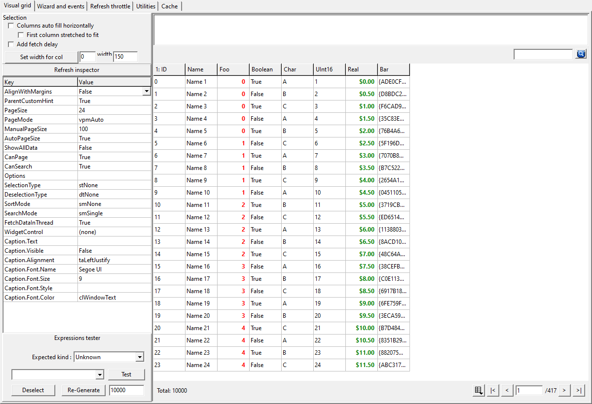
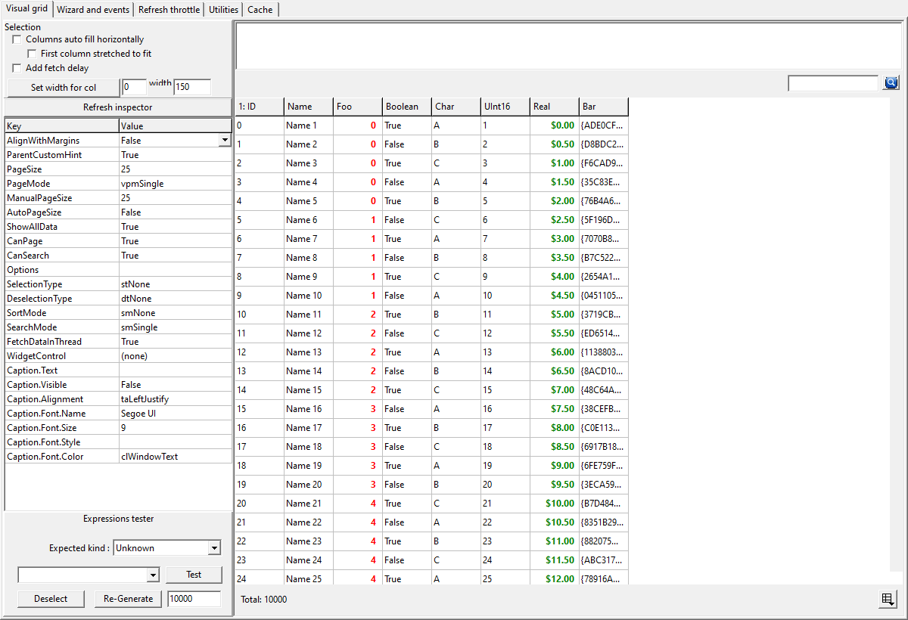
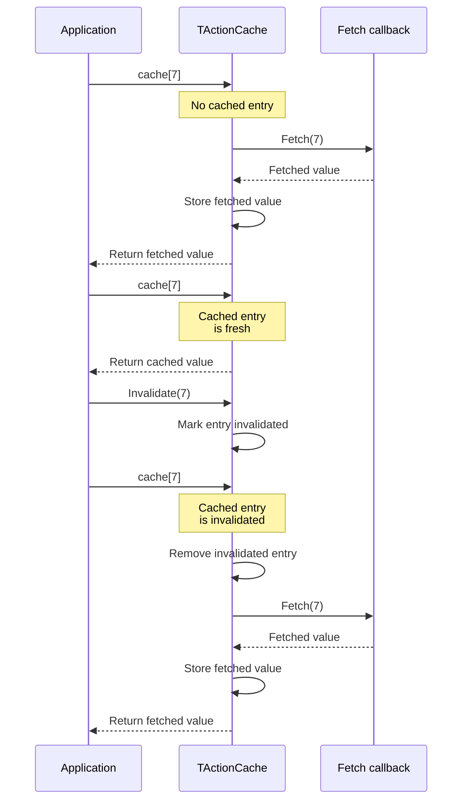
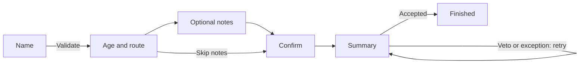
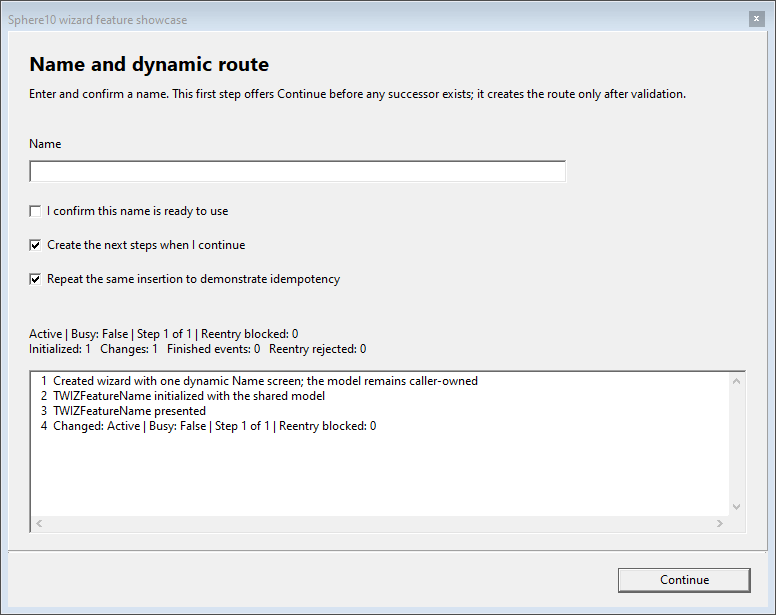
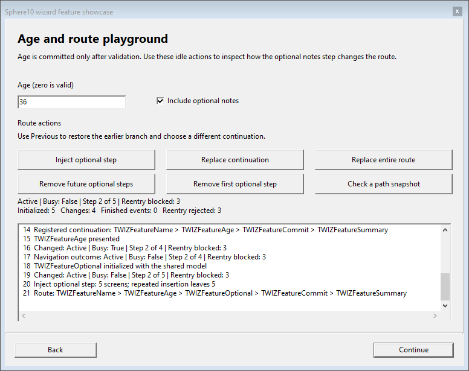
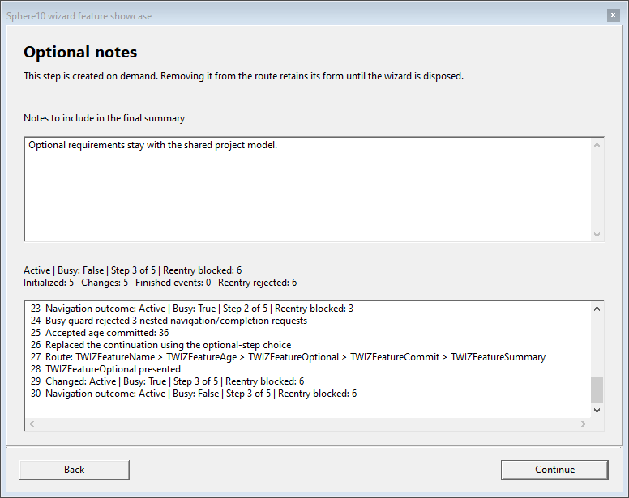
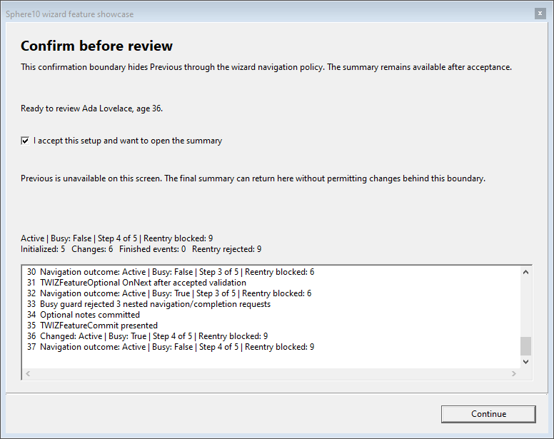
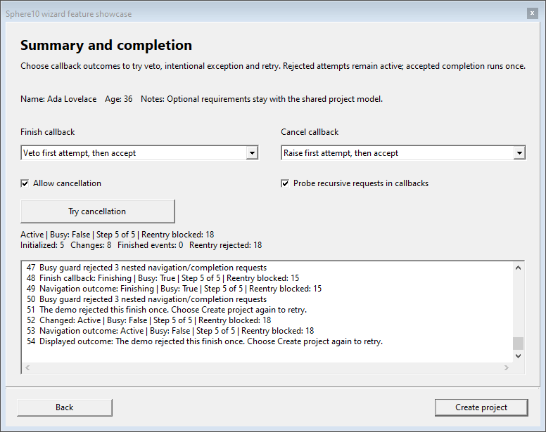

<p align="center">
  <a href="https://sphere10.com/"></a>
</p>

[](https://github.com/HermanSchoenfeld/PascalFramework/actions/workflows/main.yml)
[](packages/README.md#delphi-13)
[](tests/README.md)
[](tests/README.md)
[](tests/README.md)
[](tests/README.md)
[](LICENSE)

# Sphere 10 Pascal Framework

Sphere 10 Pascal Framework is [Sphere10's](https://sphere10.com/) reusable Object Pascal
library for **Lazarus/FPC (LCL) and Delphi (VCL)**. It provides data-bound
visual grids, multi-step wizards, configurable caches and supporting utilities.

Use the units directly or through the optional [Lazarus or Delphi package](packages/README.md).
[Sphere10PascalFramework.dproj](Sphere10PascalFramework.dproj) (Delphi) and
[Sphere10PascalFramework.lpi](Sphere10PascalFramework.lpi) (Lazarus) build the
[demo](examples/demo/README.md) from one [entry point](Sphere10PascalFramework.dpr).

The projects target **Delphi 13 Community Edition**, **Lazarus 2.1 with Free Pascal
3.2.0** and **Lazarus 4.8 with Free Pascal 3.2.2** on Windows. Lazarus uses the
Win32 widgetset, also for Win64. See the [build instructions](#open-build-and-test).
The [CI workflow](.github/CI.md) builds the Lazarus package and demo, then runs FPCUnit
and the native viewport check.

## Units

| Unit | Description |
| --- | --- |
| [UVisualGrid.pas](src/Sphere10/UVisualGrid.pas) | Data-bound grid with paging, search, sorting and background fetching. |
| [UCache.pas](src/Sphere10/UCache.pas) | Per-key, bulk-fetch and preloaded caches. |
| [UWizard.pas](src/Sphere10/UWizard.pas) | Typed-model wizards with validation and dynamic routes. |
| [UMemory.pas](src/Sphere10/UMemory.pas) | `TDisposables` cleanup of objects and memory. |
| [UCommon.pas](src/Sphere10/UCommon.pas) | `TScope` cleanup and array, date, byte, result, event and file helpers. |
| [UCommon.Collections.pas](src/Sphere10/UCommon.Collections.pas) | Composable comparers, predicates, transformers and list helpers. |
| [UCommon.Data.pas](src/Sphere10/UCommon.Data.pas) | Variant rows, search expressions and paged data sources. |
| [UStreams.pas](src/Sphere10/UStreams.pas) | Read-ahead buffered stream. |
| [UCommon.UI.pas](src/Sphere10/UCommon.UI.pas) | Application forms, `TLoadingCircle` and throttled UI events. |
| [UConcurrency.pas](src/Sphere10/UConcurrency.pas) | Read-write lock with upgradeable reads. |

Each framework unit opens with a **Public types in this unit** table.

Free Pascal builds use the bundled [Generics.Collections](src/Generics.Collections/generics.collections.pas)
library, and Delphi uses its RTL generics.

# Examples

## Visual grid

[TVisualGrid](src/Sphere10/UVisualGrid.pas) shows a data source with paging, search,
multi-column sorting and cell, row or multi-row selection. It also takes custom
cell renderers, selection callbacks, popup menus and toolbar controls.



Set `PageMode`, or use the paging button in the footer:

| Mode | Displays |
| --- | --- |
| Single (`vpmSingle`) | Every matching row in one page. |
| Auto (`vpmAuto`) | The complete rows that fit the viewport. |
| [Manual](resources/demo/unified-grid-manual.png) (`vpmManual`) | `ManualPageSize` rows. |

New grids default to Manual with 100 rows.



### Data sources

Subclass [TCustomDataSource<T>](src/Sphere10/UCommon.Data.pas) and implement three
methods. The base class supplies filtering, sorting, paging and conversion to named
Variant rows.

```pascal
uses Classes, Variants, Generics.Collections, UCommon.Data;

type
  TNameSource = class(TCustomDataSource<String>)
  protected
    function GetColumns : TDataColumns; override;
    procedure FetchAll(const AContainer : TList<String>); override;
    function GetItemField({$IFDEF FPC}constref{$ELSE}const{$ENDIF} AItem : String; const ABindingName : String) : Variant; override;
  end;

function TNameSource.GetColumns : TDataColumns;
begin
  Result := TDataColumns.Create(TDataColumn.From('Name'));
end;

procedure TNameSource.FetchAll(const AContainer : TList<String>);
begin
  AContainer.Add('Ada');
  AContainer.Add('Grace');
end;

function TNameSource.GetItemField({$IFDEF FPC}constref{$ELSE}const{$ENDIF} AItem : String; const ABindingName : String) : Variant;
begin
  Result := AItem;
end;
```

Attach the source to a grid from your form:

```pascal
uses Controls, Forms, UCommon.Data, UCommon.UI, UVisualGrid;

procedure ShowNames(AForm : TForm; AContainer : TWinControl);
var
  source : TNameSource;
  grid : TVisualGrid;
begin
  source := TNameSource.Create(AForm);
  source.SnapshotCacheEnabled := true;
  grid := TVisualGrid.Create(AForm);
  grid.FetchDataInThread := false;
  grid.ManualPageSize := 25; // Remember this size when Manual is selected.
  grid.PageMode := vpmAuto;
  with grid.AddColumn('Name') do begin
    Binding := 'Name';
    Filters := SORTABLE_TEXT_FILTER;
  end;
  AContainer.AddControlDockCenter(grid); // A panel or page on the form.
  grid.DataSource := source; // Fetch the first page.
end;
```

Custom data sources must treat a nonpositive requested page size as unbounded.

### Refresh throttle


Each grid owns a [RefreshThrottle](src/Sphere10/UVisualGrid.pas), which admits
requests at once by default (`temNone`). To wait for five quiet seconds, configure
it before assigning `DataSource`:

```pascal
uses UCommon, UCommon.UI, UVisualGrid;

procedure TMyForm.ConfigureGridRefresh;
begin
  FGrid.RefreshThrottle.Interval := TTimeSpan.FromSeconds(5);
  FGrid.RefreshThrottle.Mode :=
    TThrottledEventMode.temNotifyOnEventBurstStartAndFinished;
  FGrid.RefreshThrottle.OnWaitingChanged.Add(GridWaitingChanged);
end;

procedure TMyForm.GridWaitingChanged(Sender : TObject);
begin
  if FGrid.RefreshSuspended then Exit; // Preserve an application-owned hold card.
  if FGrid.RefreshThrottle.Waiting then
    FGrid.ShowLoading('Please Wait', 'Synchronizing')
  else
    FGrid.HideLoading;
end;
```

The first request fetches at once. Later requests, including paging, sorting and
resizes, restart the quiet timer, and only the latest runs after five quiet
seconds. Configure the throttle and handle its events on the UI thread. Remove a
listener before freeing it if the grid outlives it.

### Refresh suspension

To hold provider queries during your own work, set `RefreshSuspended`. It cancels
an active fetch without waiting, so providers should check their worker's
termination flag during lengthy work:

```pascal
procedure TMyForm.ImportStarted;
begin
  FGrid.RefreshSuspended := True;
  FGrid.ShowLoading('Please Wait', 'Importing');
end;

procedure TMyForm.ImportFinished;
begin
  FGrid.HideLoading;
  FGrid.RefreshThrottle.Cancel; // Cancel while suspended: no early query.
  FGrid.RefreshSuspended := False; // Resume one latest retained request.
end;
```

Call these methods on the UI thread. Resuming honors any remaining throttle wait
unless you cancel the throttle first, as above.

### Background fetching

Call [RefreshGrid](src/Sphere10/UVisualGrid.pas) after changing source data. To
fetch on a worker thread, set `FetchDataInThread := true` and:

- Keep the grid and source alive until the fetch completes.
- Keep source callbacks free of LCL and VCL control access.
- Publish UI state through the grid's completion event on the main thread.

To reconfigure a provider, call `grid.CancelActiveFetch`, update the provider, then
call `RefreshGrid`. Cancellation neither waits for the worker nor frees the
provider, so keep it alive until the worker retires.

See the [unified grid demo](examples/demo/fMain.pas) for rendering and selection,
and the [SQLite adapter recipe](examples/demo/sqlite/fMain.pas) for the older
optional mORMot integration.

### Snapshot caching

[SnapshotCacheEnabled](src/Sphere10/UCommon.Data.pas) is off by default. Enable it
for a dataset that stays stable between updates. After changing the data,
invalidate the snapshot before refreshing:

```pascal
procedure RefreshNames(ASource : TNameSource; AGrid : TVisualGrid);
begin
  ASource.InvalidateSnapshot;
  AGrid.RefreshGrid;
end;
```

Keep object items alive while snapshots and fetches use them.

The default [FetchPage](src/Sphere10/UCommon.Data.pas) loads everything through
`FetchAll`. Override it to let a database or index do the paging. The override must
return accurate counts and page bounds, and filter and sort the complete query
before paging.

### Loading cards

Pending refreshes show a [TLoadingCircle](src/Sphere10/UCommon.UI.pas) card after
200 ms. A failed fetch shows its error until a retry succeeds, and synchronous
providers also propagate the exception.

Use [ShowLoading and HideLoading](src/Sphere10/UVisualGrid.pas) to hold a card during
external work. The grid copies the optional `TGraphic`, so you keep ownership.

```pascal
grid.ShowLoading('Please Wait', 'Importing records', MyLoadingImage);
// Grid, search and paging input are disabled; completed rows remain visible.
// Programmatic refreshes can still publish replacement pages.
grid.RefreshGrid;
// Call when the external work and required page publication have finished:
grid.HideLoading;
```

The optional fourth parameter, `ADisableInput`, defaults to `true`. Fetch completion
cannot dismiss a held card. `LoadingVisible` reports a held card, and `IsUpdating`
reports only a fetch. Call these methods on the main thread.

## Loading circle

[TLoadingCircle](src/Sphere10/UCommon.UI.pas) is an animated loading indicator for
LCL and VCL. Set `Active` on the UI thread while work runs.

```pascal
uses Classes, Controls, UCommon.UI;

function AddLoadingCircle(AOwner : TComponent; AParent : TWinControl) : TLoadingCircle;
begin
  Result := TLoadingCircle.Create(AOwner);
  Result.Parent := AParent;
  Result.SetBounds(12, 12, 36, 36);
  Result.Active := true;
  // Set Result.Active := false when the operation finishes.
end;
```

The port retains Martin R. Gagné's original copyright and license in the
[unit source](src/Sphere10/UCommon.UI.pas).

## Caching

[TActionCache<TKey, TValue>](src/Sphere10/UCache.pas) memoizes fetches and supports
explicit writes, invalidation, fixed or sliding expiration, eviction policies,
pinned entries, null-value policies, lifecycle events and callback adapters.
For on-demand staleness checks, override `CheckStaleness` and pass
`svpCheckStaleOnDemand`. `BulkLoad` writes pairs in order, so a failure keeps
earlier writes.

```pascal
program BasicCache;
{$IFDEF FPC}{$mode Delphi}{$H+}{$ENDIF}

uses SysUtils, UCommon, UMemory, UCache;

type
  TStringCache = TActionCache<Integer, String>;

function Fetch(const AKey : Integer) : String;
begin
  Result := 'value ' + IntToStr(AKey);
end;

function Estimate(const AValue : String) : SizeInt;
begin
  Result := Length(AValue) * SizeOf(Char);
end;

var
  cache : TStringCache;
begin
  cache := TStringCache.Create(nil,
    TCacheValueFetcher<Integer,String>.FromGlobalFunction(Fetch),
    TCacheSizeEstimator<String>.FromGlobalFunction(Estimate),
    idpNone, TCacheReapPolicy.crpLeastUsed,
    TCacheExpirationPolicy.epSinceFetchedTime,
    TCacheNullValuePolicy.nvpCacheNormally,
    1024, TTimeSpan.FromSeconds(30));
  try
    WriteLn(cache[7]);              // Fetch.
    WriteLn(cache[7]);              // Hit.
    cache.Invalidate(7);
    WriteLn(cache[7]);              // Fetch again.
    cache[8] := 'supplied value';   // Store without fetching.
    cache.Get(8).CanPurge := false; // Pin against automatic eviction.
    cache.Remove(8);               // Explicit removal ignores the pin.
  finally
    cache.Free;
  end;
end.
```

The size estimator sets the capacity unit. Return `1` to count entries instead of
bytes. Use `epSinceLastAccessedTime` for sliding expiration.

Operations and callbacks run under a recursive lock, so callbacks may use the cache
but must not destroy it. `Get` returns a borrowed entry, so keep entries and
object values alive while you use them. The value indexer returns a copy.

A read fetches a missing or invalidated entry:



Object caches use [idpFreeAndNil](src/Sphere10/UMemory.pas) to free admitted
objects on removal or destruction. A rejected explicit write leaves ownership with
the caller. Returned values stay borrowed. See [more cache examples](examples/demo/README.md#cache).

## Bulk-fetch caching

[TBulkFetchActionCache<TKey,TValue>](src/Sphere10/UCache.pas) loads a complete
dictionary in one provider call:

- The first read, `ContainsCachedItem` or `GetAllCachedValues` call loads the
  snapshot.
- Reading a missing, expired or stale entry reloads the whole snapshot once.
- `FetchOnceOnly = True` keeps loaded values despite expiry or invalidation.
- `ForceRefresh` purges before reloading, so a provider failure propagates
  and leaves no snapshot.
- `Purge` clears the snapshot. `Remove` is not supported.

```pascal
uses Classes, SysUtils, Generics.Collections, UCommon, UMemory, UCache;

type
  TCatalogue = TBulkFetchActionCache<Integer,String>;

procedure FetchCatalogue(AValues: TCacheBulkValues<Integer,String>);
begin
  // Replace these entries with one database/query result for the whole catalogue.
  AValues.Add(1,'apple');
  AValues.Add(2,'pear');
end;

procedure ShowCatalogue(AOutput: TStrings);
var
  resources: TDisposables;
  cache: TCatalogue;
  snapshot: TArray<String>;
begin
  cache := TCatalogue(resources.AddObject(TCatalogue.Create(nil,
    TCacheBulkValueFetcher<Integer,String>.FromGlobalFunction(FetchCatalogue),
    TCacheExpirationPolicy.epNone,TTimeSpan.MaxValue,True)));
  AOutput.Add(cache[1]);                 // One provider call loads keys 1 and 2.
  AOutput.Add(cache[2]);                 // Uses the already loaded snapshot.
  cache.Invalidate(1);
  AOutput.Add(cache[1]);                 // Fetch-once retains the original value.
  cache.ForceRefresh;                   // Purge first, then fetch the batch again.
  snapshot := cache.GetAllCachedValues; // A copied array of the current values.
  AOutput.Add(IntToStr(Length(snapshot)));
end; // resources frees the cache automatically.
```

The provider fills a temporary dictionary that the cache owns, and must not keep
it. Payloads are borrowed, so keep them alive while the cache or returned values
use them.

[TPreloadedCache<TKey,TValue>](src/Sphere10/UCache.pas) reads a borrowed dictionary
into a fetch-once snapshot. Keep the dictionary and its payloads alive until the
cache is freed. `ForceRefresh` picks up later edits.

```pascal
type
  TCatalogueValues = TDictionary<Integer,String>;
  TPreloadedCatalogue = TPreloadedCache<Integer,String>;

procedure ShowPreloaded(AOutput: TStrings);
var
  resources: TDisposables;
  source: TCatalogueValues;
  cache: TPreloadedCatalogue;
begin
  source := TCatalogueValues(resources.AddObject(TCatalogueValues.Create));
  source.Add(1,'apple');
  cache := TPreloadedCatalogue(resources.AddObject(
    TPreloadedCatalogue.Create(nil,source)));
  AOutput.Add(cache[1]);   // apple
  source[1] := 'apricot';
  AOutput.Add(cache[1]);   // apple: existing snapshot
  cache.ForceRefresh;
  AOutput.Add(cache[1]);   // apricot: refreshed source
end; // reverse registration order frees cache before source.
```

See the [complete executable examples](examples/demo/UCacheApiExamples.pas).

## Wizards

[TWizard<T> and TWizardForm<T>](src/Sphere10/UWizard.pas) host model-bound screens
in one modal window, with validation, dynamic routes, retryable finish and cancel
vetoes, lifecycle events and reentrancy guards. The wizard owns its screens, and
the caller owns the model. Run the showcase from an LCL or VCL application:

```pascal
uses Classes, UWizardFeatureModel, UWizardFeatureDemo;

procedure ShowFeatureWizard(AOwner : TComponent);
var
  model : TWizardFeatureModel;
  wizard : TWizardFeatureDemo;
begin
  model := TWizardFeatureModel.Create;
  try
    model.IncludeOptional := true;
    model.FinishOutcome := fcoVetoOnce;
    wizard := TWizardFeatureDemo.Create(AOwner, model);
    try
      wizard.Start(model);
    finally
      wizard.Free;
    end;
    // Inspect model.Name, model.Age and model.Events here.
  finally
    model.Free;
  end;
end;
```

In the demo, select **Wizard and events** and choose **Wizard feature showcase**.



Native LCL screens from the showcase:

| Name and validation | Age and route editing |
| --- | --- |
|  |  |
| **Optional notes** | **Confirmation boundary** |
|  |  |
| **Completion and retry** | |
|  | [Walkthrough and launcher](examples/demo/README.md) |

Derive screens from `TWizardForm<TModel>`. This minimal route adapts the demo's
[Name screen](examples/demo/UWIZFeatureName.pas). Add the listed units to its
implementation `uses` clause. `Model` is assigned before `Initialize` runs.

```pascal
uses UWizard, UWIZFeatureAge, UWIZFeatureCommit, UWIZFeatureSummary;

procedure TWIZFeatureName.Initialize;
begin
  Traits := [wstAssumeHasNext]; // This screen creates its successor later.
  inherited Initialize;
end;

function TWIZFeatureName.Validate(out message : String) : boolean;
begin
  message := '';
  if Trim(FNameEdit.Text) = '' then
    message := 'Enter a name before continuing'
  else if NOT FConfirmedCheckBox.Checked then
    message := 'Confirm the name before continuing';
  Result := message = '';
end;

procedure TWIZFeatureName.OnNext;
begin
  inherited OnNext;
  Model.Name := Trim(FNameEdit.Text);
  UpdatePath(ptInject, [TWIZFeatureAge, TWIZFeatureCommit, TWIZFeatureSummary]);
end;
```

Use `ptReplaceAllNext`, `ptReplaceAll` or `ptRemoveNext` to replace the remaining
steps, replace the whole route or remove future steps. Identical contiguous
injections are idempotent. A rejected finish or cancel keeps the wizard open for a
retry, and accepted completion runs once.

## Managed scopes

[TScope](src/Sphere10/UCommon.pas) is a managed record that runs a cleanup method
when its last copy is finalized, including on `Exit` and exceptions. Scopes can be
returned and copied.

```pascal
program ManagedScope;

{$IFDEF FPC}{$mode Delphi}{$H+}{$ENDIF}
uses Classes, UCommon, UMemory;

procedure Demo;
var
  Resources: TDisposables;
  Lines: TStringList;

  procedure Work;
  var Scope: TScope;
  begin
    Scope := TScope.Create(Lines.Clear);
    Lines.Add('Working');
    WriteLn(Lines[0]);
  end; // Calls Lines.Clear automatically.

begin
  Lines := Resources.AddObject(TStringList.Create) as TStringList;
  Work;
  WriteLn('Items after scope: ', Lines.Count); // 0
end;

begin
  Demo;
end.
```

- `Create` rejects nil. The scope does not own the method's target, which must
  outlive it.
- `Reset` drops this record's ownership. Other copies, including compiler-generated
  result temporaries, can keep the cleanup until their routine exits.
- Keep cleanup on the thread that its resource requires.
- Cleanup errors propagate.

The [shared executable example](examples/demo/UCoreApiExamples.pas) also uses
custom cleanup and lock scopes.

## Scoped disposal

[TDisposables](src/Sphere10/UMemory.pas) is a record that frees its registered
objects and memory in reverse order when its scope ends, even on an exception.

```pascal
uses Classes, UMemory;

function BuildLocalReport : String;
var
  scope : TDisposables;
  lines : TStringList;
  text : TStringStream;
  output : TMemoryStream;
  scratch : Pointer;
begin
  lines := scope.AddObject(TStringList.Create) as TStringList;
  text := scope.AddObject(TStringStream.Create('Report: ')) as TStringStream;
  output := scope.AddObject(TMemoryStream.Create) as TMemoryStream;
  scope.GetMem(scratch, 256);
  scope.ReallocMem(scratch, 512);
  FillChar(scratch^, 512, 0);
  lines.Add('Ready');
  text.Position := text.Size;
  text.WriteString(lines.Text);
  output.CopyFrom(text, 0);
  Result := text.DataString;
  // Reverse cleanup: scratch, output, text, lines.
end;
```

Keep the bag in a class field to tie resources to their owner:

```pascal
type
  TReportBuilder = class
  private
    FResources : TDisposables;
    FLines : TStringList;
    FText : TStringStream;
    FOutput : TMemoryStream;
  public
    constructor Create;
    function Build : String;
  end;

constructor TReportBuilder.Create;
begin
  inherited Create;
  FLines := FResources.AddObject(TStringList.Create) as TStringList;
  FText := FResources.AddObject(TStringStream.Create('')) as TStringStream;
  FOutput := FResources.AddObject(TMemoryStream.Create) as TMemoryStream;
end;

function TReportBuilder.Build : String;
begin
  FLines.Clear;
  FText.Size := 0;
  FOutput.Size := 0;
  FLines.Add('Ready');
  FText.WriteString(FLines.Text);
  FOutput.CopyFrom(FText, 0);
  Result := FText.DataString;
end;

function BuildClassReport : String;
var
  report : TReportBuilder;
begin
  report := TReportBuilder.Create;
  try
    Result := report.Build;
  finally
    report.Free; // Finalizes FResources and frees its three objects.
  end;
end;
```

The compiler finalizes `FResources` with its owner, even after a failed
constructor, so no destructor is needed for these resources. A destructor that
uses them must do so before `inherited Destroy`. Register each object once, and
leave component-owned objects with their owner.

Transfer ownership explicitly when a resource must outlive its bag:

```pascal
function CreateReadyLines : TStringList;
var
  scope : TDisposables;
begin
  Result := scope.AddObject(TStringList.Create) as TStringList;
  Result.Add('Ready');
  scope.RemoveObject(Result); // Caller now owns the returned object.
end;

function CreateOwnedBuffer : Pointer;
var
  scope : TDisposables;
begin
  scope.GetMem(Result, 256);
  FillChar(Result^, 256, 0);
  scope.RemoveMem(Result); // Caller must eventually call System.FreeMem.
end;
```

- `AddMem` adopts a `System.GetMem` allocation, and the bag's `FreeMem` releases
  one early.
- Keep an initialized bag in its original variable or field. Do not copy or
  return it.
- Do not free a registered object yourself. Remove it first.
- If a cleanup fails, the bag still tries the rest, then raises the first error.

[TDisposePolicy](src/Sphere10/UMemory.pas) is the shared cleanup-policy enum.
`AddObject` uses `idpFree`, and `AddMem` and `GetMem` use `idpFreeMem`.
`TDisposables` does not implement `idpRelease`, so keep interfaces in interface
variables.

## Arrays and collections

[TArrayTool<T>](src/Sphere10/UCommon.pas) provides `Empty`, `Create` (one to six
values), `Contains`, `IndexOf`, `Add`, `Append`, `Prepend`, `InsertAt`, `Remove`,
`RemoveAt`, `Swap`, `MoveItem`, `Copy`, `Concat`, `_Length` and `ToArray` for
dynamic arrays. Indexes are zero-based. `Remove` removes every match, `InsertAt`
inserts before an index, and `Copy` is shallow. Pass `ToArray` the exact element
count.

[UCommon.Collections](src/Sphere10/UCommon.Collections.pas) supplies
`TComparerTool<T>`, `TPredicateTool<T>` and `TListTool`. They adapt global,
object-method and nested callbacks, compose comparers and predicates, and filter
and transform lists and arrays. Interface variables own the adapters, but a method
callback's object must outlive every use.

- `TListTool.Copy` takes a start index and a **count**, and the caller owns the new
  list.
- `Range`, `Skip` and `Take` modify the list and return the signed size change.
- Pass `idpFreeAndNil` to a filter only for rejected objects that the list owns.
- The slot-policy method is spelled `DiposeItem`.
- `TSortedHashSetTool<T>.Pop` is FPC only and rejects an empty set.

<details>
<summary>Complete checked example: every array operation and every collection adapter type</summary>

```pascal
program ArrayCollectionExamples;
{$IFDEF FPC}{$mode Delphi}{$H+}{$modeswitch nestedprocvars}{$ENDIF}
uses Classes, SysUtils, Generics.Collections, Generics.Defaults,
  UCommon, UCommon.Collections, UMemory;

type
  TIntArrays = TArrayTool<Integer>;
  TIntComparerArrays = TArrayTool<IComparer<Integer>>;
  TIntPredicateArrays = TArrayTool<IPredicate<Integer>>;
  TIntComparerTools = TComparerTool<Integer>;
  TIntPredicateTools = TPredicateTool<Integer>;
  TIntListTools = TListTool<Integer>;
  TIntTextTransforms = TListTool<Integer,String>;
  {$IFDEF FPC}TIntSetTools = TSortedHashSetTool<Integer>;{$ENDIF}

procedure Require(ACondition: Boolean; const AMessage: String);
begin
  if not ACondition then raise Exception.Create(AMessage);
end;

procedure RequireArray(const AActual: TArray<Integer>; const AExpected: array of Integer);
var I: Integer;
begin
  Require(Length(AActual)=Length(AExpected),'Array length');
  for I:=0 to High(AActual) do Require(AActual[I]=AExpected[I],'Array value');
end;

procedure ArrayMethods;
var
  values, snapshot, middle, combined: TArray<Integer>;
  equality: IEqualityComparer<Integer>;
  index: SizeInt;
  scope: TDisposables;
  list: TList<Integer>;
begin
  values := TIntArrays.Empty;
  Require(Length(values)=0,'Empty');
  // Create has overloads for one through six values.
  values := TIntArrays.Create(10);
  RequireArray(values,[10]);
  values := TIntArrays.Create(10,20);
  RequireArray(values,[10,20]);
  values := TIntArrays.Create(10,20,30);
  RequireArray(values,[10,20,30]);
  values := TIntArrays.Create(10,20,30,40);
  RequireArray(values,[10,20,30,40]);
  values := TIntArrays.Create(10,20,30,40,50);
  RequireArray(values,[10,20,30,40,50]);
  values := TIntArrays.Create(10,20,30,40,50,60);
  RequireArray(values,[10,20,30,40,50,60]);

  values := TIntArrays.Create(10,20,30);
  TIntArrays.Add(values,40);               // 10,20,30,40
  TIntArrays.Append(values,50);            // 10,20,30,40,50
  TIntArrays.Prepend(values,0);            // 0,10,20,30,40,50
  TIntArrays.InsertAt(values,2,15);         // 0,10,15,20,30,40,50
  TIntArrays.Swap(values,0,6);             // 50,10,15,20,30,40,0
  TIntArrays.MoveItem(values,6,0);         // 0,50,10,15,20,30,40
  TIntArrays.Remove(values,20);            // 0,50,10,15,30,40
  equality := TEqualityComparer<Integer>.Default;
  TIntArrays.Remove(values,50,equality);   // 0,10,15,30,40
  TIntArrays.RemoveAt(values,0);           // 10,15,30,40
  RequireArray(values,[10,15,30,40]);

  snapshot := TIntArrays.Copy(values);
  middle := TIntArrays.Copy(values,1,2);   // 15,30
  combined := TIntArrays.Concat([
    middle,TIntArrays.Create(50,60)]);     // 15,30,50,60
  values[0] := 99;                                 // snapshot still starts with 10.
  RequireArray(snapshot,[10,15,30,40]);
  RequireArray(middle,[15,30]);
  RequireArray(combined,[15,30,50,60]);
  Require(TIntArrays.Contains(combined,30,index),'Contains/out');
  Require(index=1,'Contains/out index');
  Require(TIntArrays.Contains(combined,60,equality,index),'Contains/comparer');
  Require(index=3,'Contains/comparer index');
  Require(not TIntArrays.Contains(combined,999),'Contains/bool');
  Require(TIntArrays.IndexOf(combined,50)=2,'IndexOf');
  Require(TIntArrays.IndexOf(combined,15,equality)=0,'IndexOf/comparer');
  Require(TIntArrays._Length(combined)=4,'_Length');
  list := scope.AddObject(TList<Integer>.Create) as TList<Integer>;
  list.AddRange(combined);
  values := TIntArrays.ToArray(list,list.Count);
  RequireArray(values,[15,30,50,60]);
  Writeln('PASS all TArrayTool methods and overloads');
end;

function Ascending({$IFDEF FPC}constref{$ELSE}const{$ENDIF} ALeft,ARight: Integer): Integer;
begin
  Result := TComparer<Integer>.Default.Compare(ALeft,ARight);
end;

function Even({$IFDEF FPC}constref{$ELSE}const{$ENDIF} AValue: Integer): Boolean;
begin
  Result := (AValue mod 2)=0;
end;

function NumberText({$IFDEF FPC}constref{$ELSE}const{$ENDIF} AValue: Integer): String;
begin
  Result := 'item '+IntToStr(AValue);
end;

type
  TCallbacks = class
    function Compare({$IFDEF FPC}constref{$ELSE}const{$ENDIF} ALeft,ARight: Integer): Integer;
    function Positive({$IFDEF FPC}constref{$ELSE}const{$ENDIF} AValue: Integer): Boolean;
    function Text({$IFDEF FPC}constref{$ELSE}const{$ENDIF} AValue: Integer): String;
  end;

function TCallbacks.Compare({$IFDEF FPC}constref{$ELSE}const{$ENDIF} ALeft,ARight: Integer): Integer;
begin
  Result := Ascending(ALeft,ARight);
end;
function TCallbacks.Positive({$IFDEF FPC}constref{$ELSE}const{$ENDIF} AValue: Integer): Boolean;
begin
  Result := AValue>0;
end;
function TCallbacks.Text({$IFDEF FPC}constref{$ELSE}const{$ENDIF} AValue: Integer): String;
begin
  Result := 'object '+IntToStr(AValue);
end;

procedure CollectionAdapters;
var
  scope: TDisposables;
  callbacks: TCallbacks;
  globalCompare: TGlobalComparerFunc<Integer>;
  objectCompare: TObjectComparerFunc<Integer>;
  nestedCompare: TNestedComparerFunc<Integer>;
  globalPredicate: TGlobalPredicateFunc<Integer>;
  objectPredicate: TObjectPredicateFunc<Integer>;
  nestedPredicate: TNestedPredicateFunc<Integer>;
  globalTransform: TGlobalTransformFunc<Integer,String>;
  objectTransform: TObjectTransformFunc<Integer,String>;
  nestedTransform: TNestedTransformFunc<Integer,String>;
  globalComparer,objectComparer,nestedComparer,combinedComparer,invertedComparer: IComparer<Integer>;
  globalFilter,objectFilter,nestedFilter,both,either,negated: IPredicate<Integer>;
  globalTransformer,objectTransformer,nestedTransformer: ITransformer<Integer,String>;
  list, copied: TList<Integer>;
  numbers: TArray<Integer>;
  texts: TArray<String>;
  {$IFDEF FPC}setOfNumbers: TSortedHashSet<Integer>; popped: Integer;{$ENDIF}

  {$IFDEF FPC}
  function CompareInScope(constref ALeft,ARight: Integer): Integer;
  begin
    Result := Ascending(ALeft,ARight);
  end;
  function UnderTen(constref AValue: Integer): Boolean;
  begin
    Result := AValue<10;
  end;
  function ScopedText(constref AValue: Integer): String;
  begin
    Result := 'nested '+IntToStr(AValue);
  end;
  {$ENDIF}
begin
  callbacks := scope.AddObject(TCallbacks.Create) as TCallbacks;
  globalCompare := Ascending; objectCompare := callbacks.Compare;
  globalPredicate := Even; objectPredicate := callbacks.Positive;
  globalTransform := NumberText; objectTransform := callbacks.Text;
  {$IFDEF FPC}
  nestedCompare := CompareInScope; nestedPredicate := UnderTen; nestedTransform := ScopedText;
  {$ELSE}
  nestedCompare :=
    function(const L,R: Integer): Integer
    begin
      Result := Ascending(L,R);
    end;
  nestedPredicate :=
    function(const V: Integer): Boolean
    begin
      Result := V<10;
    end;
  nestedTransform :=
    function(const V: Integer): String
    begin
      Result := 'nested '+IntToStr(V);
    end;
  {$ENDIF}

  // The factories return reference-counted interfaces. These concrete adapters
  // are also public, although declared for compiler compatibility.
  globalComparer := TGlobalComparer<Integer>.Create(globalCompare);
  objectComparer := TObjectComparer<Integer>.Create(objectCompare);
  nestedComparer := TNestedComparer<Integer>.Create(nestedCompare);
  combinedComparer := TManyComparer<Integer>.Create(
    TIntComparerArrays.Create(globalComparer,objectComparer));
  invertedComparer := TInvertedComparer<Integer>.Create(combinedComparer);
  Require(invertedComparer.Compare(1,2)>0,'Concrete comparer adapters');
  Require(nestedComparer.Compare(1,2)<0,'Nested comparer');
  globalComparer := TIntComparerTools.FromFunc(globalCompare);
  objectComparer := TIntComparerTools.FromFunc(objectCompare);
  nestedComparer := TIntComparerTools.FromFunc(nestedCompare);
  combinedComparer := TIntComparerTools.Many([globalComparer,objectComparer]);
  invertedComparer := TIntComparerTools.Inverted(combinedComparer);
  Require(invertedComparer.Compare(1,2)>0,'Comparer tool');
  Require(TIntComparerTools.AlwaysEqual.Compare(1,2)=0,'AlwaysEqual');

  globalFilter := TGlobalPredicate<Integer>.Create(globalPredicate);
  objectFilter := TObjectPredicate<Integer>.Create(objectPredicate);
  nestedFilter := TNestedPredicate<Integer>.Create(nestedPredicate);
  both := TAndManyPredicate<Integer>.Create(
    TIntPredicateArrays.Create(globalFilter,objectFilter));
  either := TOrManyPredicate<Integer>.Create(
    TIntPredicateArrays.Create(globalFilter,nestedFilter));
  negated := TNotPredicate<Integer>.Create(globalFilter);
  Require(both.Evaluate(2) and not both.Evaluate(-2),'And predicate');
  Require(either.Evaluate(3) and not either.Evaluate(11),'Or predicate');
  Require(negated.Evaluate(3),'Not predicate');
  both := TIntPredicateTools.AndMany([globalFilter,objectFilter]);
  either := TIntPredicateTools.OrMany([globalFilter,nestedFilter]);
  negated := TIntPredicateTools.NegatePredicate(globalFilter);
  Require(both.Evaluate(2) and either.Evaluate(3) and negated.Evaluate(3),'Predicate tool');
  globalFilter := TIntPredicateTools.FromFunc(globalPredicate);
  objectFilter := TIntPredicateTools.FromFunc(objectPredicate);
  nestedFilter := TIntPredicateTools.FromFunc(nestedPredicate);
  both := TIntPredicateTools.TruePredicate;
  either := TIntPredicateTools.FalsePredicate;
  Require(both.Evaluate(0) and not either.Evaluate(0),'Constant predicates');

  globalTransformer := TGlobalTransformer<Integer,String>.Create(globalTransform);
  objectTransformer := TObjectTransformer<Integer,String>.Create(objectTransform);
  nestedTransformer := TNestedTransformer<Integer,String>.Create(nestedTransform);
  Require(globalTransformer.Transform(2)='item 2','Global transformer');
  Require(objectTransformer.Transform(2)='object 2','Object transformer');
  Require(nestedTransformer.Transform(2)='nested 2','Nested transformer');
  numbers := TIntArrays.Create(1,2,3,4);
  texts := TIntTextTransforms.Transform(numbers,globalTransformer);
  Require((Length(texts)=4) and (texts[3]='item 4'),'Interface array transform');
  list := scope.AddObject(TList<Integer>.Create) as TList<Integer>;
  list.AddRange(numbers);
  texts := TIntTextTransforms.Transform(list,objectTransformer);
  Require(texts[0]='object 1','Interface list transform');
  // Function-adapter overloads work on both arrays and lists.
  texts := TIntTextTransforms.Transform(numbers,globalTransform);
  Require(texts[0]='item 1','Global array transform');
  texts := TIntTextTransforms.Transform(numbers,objectTransform);
  Require(texts[0]='object 1','Object array transform');
  texts := TIntTextTransforms.Transform(numbers,nestedTransform);
  Require(texts[0]='nested 1','Nested array transform');
  texts := TIntTextTransforms.Transform(list,globalTransform);
  Require(texts[0]='item 1','Global list transform');
  texts := TIntTextTransforms.Transform(list,objectTransform);
  Require(texts[0]='object 1','Object list transform');
  texts := TIntTextTransforms.Transform(list,nestedTransform);
  Require(texts[0]='nested 1','Nested list transform');
  TIntListTools.FilterBy(list,globalFilter); // list now contains 2,4.
  list.Sort(invertedComparer); // 4,2.
  Require((list.Count=2) and (list[0]=4) and (list[1]=2),'List filter/sort');
  Require(TIntListTools.RemoveBy(list,objectFilter)=2,'Remove matching items');
  list.AddRange([10,20,30,40]);
  copied := scope.AddObject(TIntListTools.Copy(list,1,2)) as TList<Integer>;
  Require((copied.Count=2) and (copied[0]=20) and (copied[1]=30),'Copy count');
  Require(TIntListTools.Range(list,1,3)=-1,'Range size delta'); // 20,30,40
  Require(TIntListTools.Skip(list,1)=-1,'Skip size delta');    // 30,40
  Require(TIntListTools.Take(list,1)=-1,'Take size delta');    // 30
  TIntListTools.DiposeItem(list,0,idpNil); // Zero the slot; this does not remove it.
  Require((list.Count=1) and (list[0]=0),'Explicit item policy');
  {$IFDEF FPC}
  setOfNumbers := scope.AddObject(TSortedHashSet<Integer>.Create) as TSortedHashSet<Integer>;
  setOfNumbers.Add(1); setOfNumbers.Add(3);
  popped := TIntSetTools.Pop(setOfNumbers);
  Require((setOfNumbers.Count=1) and not setOfNumbers.Contains(popped),'Sorted set Pop');
  {$ENDIF}
  Writeln('PASS public comparer, predicate, transformer and collection adapter types');
end;

begin
  ArrayMethods;
  CollectionAdapters;
end.
```

</details>

## Results and diagnostics

[TResult](src/Sphere10/UCommon.pas) carries a Variant value and timestamped debug,
info, warning or error messages. `IsSuccess` and `IsFailure` report the error
status, and `ToString` formats the messages.

```pascal
uses UCommon;

function ValidateName(const AName : String) : TResult;
begin
  if AName = '' then
    Exit(TResult.Failure('Enter a name'));
  Result := TResult.Success('Name accepted');
  Result.Value := AName;
end;
```

## Dates, bytes and statistics

[UCommon](src/Sphere10/UCommon.pas) provides `TDateTimeHelper` and `TTimeSpan` for
date and duration arithmetic, `Hex2Bytes` and `Bytes2Hex`, `TVariantTool` for
Variant comparisons and `TStatistics` for running statistics.

```pascal
uses SysUtils, UCommon;

procedure CommonExample;
var
  expires : TDateTime;
  bytes : TBytes;
  stats : TStatistics;
begin
  expires := TDateTime.Now.AddMinutes(5);
  bytes := Hex2Bytes('00FF');
  WriteLn(Bytes2Hex(bytes));                // 00FF.
  stats.Reset;
  stats.AddDatum(10);
  stats.AddDatum(20);
  stats.AddDatum(30);
  WriteLn(stats.Mean:0:1);                  // 20.0.
  WriteLn(TVariantTool.NumericGTE(21, 18));  // TRUE.
end;
```

`TBox<T>` wraps a value in an object, and `TCPUTool.GetLogicalCPUCount` counts
logical processors. `TFileTool.AppendText` appends UTF-8 text and CRLF without a
BOM, and Delphi's `TFileStreamHelper.WriteString` writes UTF-8 without a newline.

## Buffered streams

[TBufferedStream](src/Sphere10/UStreams.pas) reads ahead from a wrapped `TStream`
through a fixed buffer, 64 KiB by default. It accepts forward-only streams and
writes immediately. Each `Read` makes at most one wrapped read and can return fewer
bytes than requested.

```pascal
uses Classes, UStreams;

function ReadHeader(const AFileName: String): Cardinal;
var
  LInput: TStream;
begin
  LInput := TFileStream.Create(AFileName, fmOpenRead or fmShareDenyWrite);
  try
    // Buffer small serialized fields; denied writes make length caching valid.
    LInput := TBufferedStream.Create(LInput, 64 * 1024, True, True, True);
    LInput.ReadBuffer(Result, SizeOf(Result));
  finally
    LInput.Free;
  end;
end;
```

Pass `False` for ownership to leave the input open. While buffering, access the
input only through the decorator. Call `FlushUnreadData` (alias
`SynchronizePosition`) to return unread bytes to a seekable input before handing it
back. A forward-only input cannot recover unread bytes.

`EnableReadBuffering` and `EnableStreamLengthCaching` default to `True`. The fourth
constructor argument sets length caching and the fifth sets read buffering.
Disable length caching for inputs that can grow independently.

`EnableBuffering` and `DisableBuffering` switch both flags. With unread bytes,
disabling raises an exception, so consume them or call `FlushUnreadData` first. For
direct reads with a cached length, set only `EnableReadBuffering := False`.

```pascal
procedure ReadSections(AInput: TBufferedStream);
var
  LHeader: Cardinal;
  LBlock: array[0..32767] of Byte;
begin
  // Read-ahead combines the small fields of a serialized header.
  AInput.EnableBuffering;
  AInput.ReadBuffer(LHeader, SizeOf(LHeader));
  AInput.FlushUnreadData;
  // This section supplies its own bulk buffer, so avoid the intermediate copy.
  AInput.DisableBuffering;
  AInput.ReadBuffer(LBlock, SizeOf(LBlock));
  AInput.EnableBuffering;
end;
```

## Multicast events

[TNotifyManyEvent](src/Sphere10/UCommon.pas) invokes several object-method
listeners together.

```pascal
uses Classes, UCommon;

type
  TDocument = class
  private
    FChanged : TNotifyManyEvent;
    procedure HandleChanged(Sender : TObject);
  public
    procedure Demonstrate;
  end;

procedure TDocument.HandleChanged(Sender : TObject);
begin
  WriteLn('Document changed');
end;

procedure TDocument.Demonstrate;
begin
  FChanged.Add(HandleChanged);
  try
    FChanged.Invoke(Self);
  finally
    FChanged.Remove(HandleChanged);
  end;
end;
```

`Add(HandleChanged, True)` runs that listener on the main thread and queues calls
from workers. Queued senders and receivers must stay alive until delivery.

## Read-write locking

[TReadWriteLock](src/Sphere10/UConcurrency.pas) allows **multiple concurrent readers
or one exclusive writer**. Take an upgradeable read when an inspection may lead to
a change. Keep the returned [TScope](src/Sphere10/UCommon.pas) in a local to release
the lock automatically:

```pascal
uses UCommon, UConcurrency;

procedure ChangeValue(Gate: TReadWriteLock; var Value: Integer);
var
  Scope: TScope;
begin
  Scope := Gate.EnterWriteScope;
  Inc(Value);
end; // Also releases on Exit or an exception.

function ReadValue(Gate: TReadWriteLock; var Value: Integer): Integer;
var
  Scope: TScope;
begin
  Scope := Gate.EnterReadScope;
  Result := Value;
end;

procedure ChangeIfNeeded(Gate: TReadWriteLock; var Value: Integer);
var
  Scope: TScope;
begin
  Scope := Gate.EnterUpgradeableReadScope;
  if Value = 0 then ChangeValue(Gate, Value);
  // ChangeValue's write scope has ended; this upgradeable scope remains held.
end;
```

Keep the lock alive until every scope copy ends, and finalize scopes on the
acquiring thread. Under FPC, a nested `begin`/`end` does not end a scope early, so
use a helper procedure, as above, when an inner write must finish first.

For explicit ownership, use `Acquire*Lock`, `TryAcquire*Lock` and `Release*Lock`:

```pascal
uses UConcurrency;

procedure LockExample;
var
  gate: TReadWriteLock;
  value: Integer;
begin
  gate := TReadWriteLock.Create(lrpNoRecursion);
  try
    value := 0;
    gate.AcquireWriteLock;
    try
      Inc(value);
    finally
      gate.ReleaseWriteLock;
    end;

    // Other threads may hold their own read locks concurrently.
    if gate.TryAcquireReadLock(0) then
    try
      WriteLn(value);
    finally
      gate.ReleaseReadLock;
    end;

    // Choose upgradeable mode before work that may need a write.
    gate.AcquireUpgradeableReadLock;
    try
      if value = 1 then begin
        gate.AcquireWriteLock;
        try
          value := 2;
        finally
          gate.ReleaseWriteLock;
        end;
      end;
      // The surrounding upgradeable acquisition is still held here.
    finally
      gate.ReleaseUpgradeableReadLock;
    end;
  finally
    gate.Free;
  end;
end;
```

- To promote, acquire the write while holding the upgradeable read, even with
  `lrpNoRecursion`. `ReleaseWriteLock` releases only the write.
- Release each acquisition, including recursive ones, in its own mode on the
  acquiring thread.
- `TryAcquire*Lock` takes milliseconds. `-1` waits indefinitely and `0` tests
  immediately.
- `lrpNoRecursion` is the default. `lrpSupportsRecursion` permits nested ownership,
  including a writer taking a read lock.
- A plain read lock cannot become a write or upgradeable lock.
- Stop and join consumer threads before freeing the lock.

See the [shared regression cases](tests/UConcurrency.Tests.pas).

## Throttled UI events

[TThrottledEvent](src/Sphere10/UCommon.UI.pas) coalesces repeated UI events and
needs an active LCL or VCL message loop. Create it with an owner, then call
`Notify` from UI handlers:

```pascal
uses Classes, UCommon, UCommon.UI;

function CreateRefreshEvent(AOwner : TComponent; AHandler : TNotifyEvent) : TThrottledEvent;
begin
  Result := TThrottledEvent.Create(AOwner);
  Result.Interval := TTimeSpan.FromMilliseconds(250);
  Result.Mode :=
    TThrottledEventMode.temNotifyOnEventBurstFinished;
  Result.Add(AHandler);
end;
```

| Mode | Delivers |
| --- | --- |
| `temNone` | Immediately. |
| `temNotifyEveryInterval` | Periodically during a continuous burst. |
| `temNotifyOnEventBurstFinished` | After a full quiet `Interval`. |
| `temNotifyOnEventBurstStartAndFinished` | Immediately, then after a quiet `Interval` if repeated. |

When polling, call `Notify` only for a new event.

The two burst modes expose [Waiting and OnWaitingChanged](src/Sphere10/UCommon.UI.pas)
to drive a busy UI:

```pascal
procedure BindBusyState(AEvent : TThrottledEvent; AStateChanged : TNotifyEvent);
begin
  AEvent.OnWaitingChanged.Add(AStateChanged);
  AStateChanged(AEvent); // Also apply the initial state.
end;
```

The handler reads `TThrottledEvent(Sender).Waiting`, which is set before listeners
run. `Cancel` and changing `Mode` end waiting without a delivery. To try it, open
**Refresh throttle** in the [demo](examples/demo/README.md) and follow the
[timing walkthrough](examples/throttle/README.md).

## Form ownership and docking

[TApplicationForm](src/Sphere10/UCommon.UI.pas) adds first-activation and destruction
events, configurable close behavior and `AutoDispose` for form-owned noncomponent
objects. `AddControlDockCenter` docks a control to fill a container, and
`SetImageListPicture` copies an image-list entry into a `TImage`.

```pascal
uses Classes, Controls, ExtCtrls, UCommon.UI;

procedure PrepareForm(AForm : TApplicationForm; AContainer : TWinControl);
var
  names : TStringList;
  panel : TPanel;
begin
  names := AForm.AutoDispose(TStringList.Create) as TStringList;
  names.Add('Ada');
  panel := TPanel.Create(AForm);
  panel.Caption := names[0];
  AContainer.AddControlDockCenter(panel);
end;
```

Application forms hide on Close by default and keep their resources while hidden.

## Data rows and search expressions

[TDataRow and TDataColumns](src/Sphere10/UCommon.Data.pas) expose named fields
through a managed Variant. `TSearchExpressionService` parses numeric comparisons,
intervals and text matches. Use one schema ID for each column set. Field names are
case-sensitive.

```pascal
uses SysUtils, Variants, UCommon.Data;

type
  TPersonSchema = class end;

procedure ShowPerson;
var
  columns : TDataColumns;
  row : Variant;
  expression : TExpressionRecord;
begin
  columns := TDataColumns.Create(
    TDataColumn.From('ID', true), TDataColumn.From('Name'));
  row := TDataRow.New(PtrInt(TPersonSchema), columns);
  row.ID := 7;
  row.Name := 'Ada';
  WriteLn(VarToStr(row.Name));
  expression := TSearchExpressionService.Parse('>=18');
  // ekNum, nckNumericGTE, Values[0] = '18'.
  expression := TSearchExpressionService.Parse('[10,20]'); // Inclusive interval.
  expression := TSearchExpressionService.Parse('Ada%');  // Text prefix.
end;
```

Column names and bindings use native `String`, so data-source overrides must
declare `GetItemField(...; const ABindingName: String)`.

## Complete API recipes

The demo's **Utilities** tab runs the [array and collection](examples/demo/UArrayCollectionExamples.pas),
[scoped resource](examples/demo/UDisposalReadmeExamples.pas),
[core utility](examples/demo/UCoreApiExamples.pas) and
[grid and wizard](examples/demo/UUiApiExamples.pas) recipes. The **Cache** tab's
**Run complete cache API** runs the [cache recipes](examples/demo/UCacheApiExamples.pas).
The array, core and UI recipes check their results. The
[public type index](docs/public-api-examples.md) maps each public Framework type to
its worked example.

# Open, build and test

Keep each form's paired `.dfm` (VCL) and `.lfm` (LCL) files.

## Delphi

Open [Sphere10PascalFramework.dproj](Sphere10PascalFramework.dproj) and press **F9**
to build and run the demo. It references `src/Sphere10` directly and needs no
installed package. Community Edition users should compile through the IDE. In your
own Delphi projects, add only `src/Sphere10` to the unit search path, as the
[package guide](packages/README.md#delphi-13) describes.

## Lazarus/FPC

Open [Sphere10PascalFramework.lpi](Sphere10PascalFramework.lpi) to build and run
the same demo. In your own projects, use Delphi mode and add `src/Sphere10` and
`src/Generics.Collections` to the unit search path.

## Tests

Run the unit suite and the native modal wizard check on Windows:

```powershell
.\tests\RunTests.ps1 `
  -FpcPath '<fpc>\bin\x86_64-win64\fpc.exe' `
  -LazarusDirectory '<lazarus>'

.\tests\RunWizardNativeTests.ps1 `
  -FpcPath '<fpc>\bin\x86_64-win64\fpc.exe' `
  -LazarusDirectory '<lazarus>'
```

Replace the tool paths for your installation. FPC's `-MDelphi` mode is not a
Delphi build, so run the [native Delphi probes](tests/native/README.md) to check
VCL behavior. The [test guide](tests/README.md) describes coverage and fixture
selection.

# License and copyright

Copyright © 2017–2026 [Herman Schoenfeld](https://sphere10.com/).

Sphere 10 Pascal Framework is distributed under the [MIT License](LICENSE). Third-party
components retain their own licenses and copyright notices in their source
directories.
