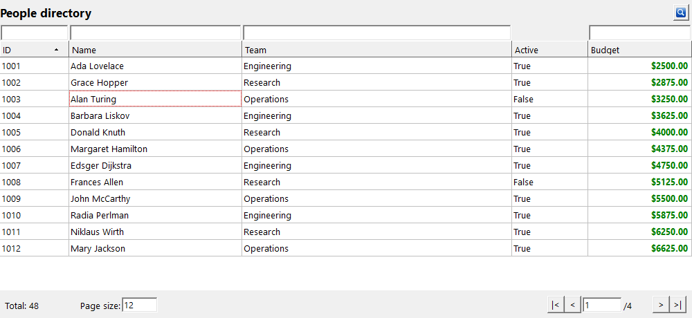
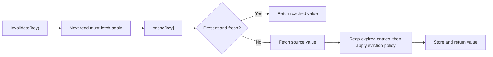
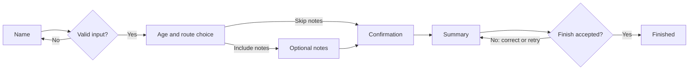

# PascalFramework

PascalFramework is a reusable Object Pascal library for Free Pascal and Lazarus,
written in Delphi mode. It provides data-bound visual grids, multi-step wizards
and configurable caches, together with the supporting utilities applications
need: scoped resource cleanup, generic collection helpers, data sources,
multicast events, date/time helpers and UI event throttling.

The components work together: visual grids consume data sources that handle
filtering, sorting and paging; wizard screens share a typed model and can change
their route at runtime; caches control how values are fetched, retained and
released. Use the units directly in a project or add the optional
[Lazarus package](packages/README.md). The examples below show their individual
APIs, with runnable projects for the grid, cache and wizard.

## Units

| Unit | Description |
| --- | --- |
| [UVisualGrid.pas](src/Sphere10/UVisualGrid.pas) | Data-bound Lazarus grid with paging and automatic page sizes, text/numeric filters, single/multi-column sorting, cell/row/multi-row selection, custom rendering, popup menus and optional background fetching. |
| [UCache.pas](src/Sphere10/UCache.pas) | Generic caches with fetch callbacks, explicit/bulk writes, invalidation, fixed/sliding expiration, capacity and eviction policies, entry pins, staleness checks, null-value policies, lifecycle events and disposal policies. |
| [UWizard.pas](src/Sphere10/UWizard.pas) | Typed-model wizard screens in one host window, with validation, Back/Continue navigation, dynamic route insertion/replacement/removal, finish/cancel vetoes, retryable completion and lifecycle notifications. |
| [UMemory.pas](src/Sphere10/UMemory.pas) | Scope-owned cleanup of objects and allocated memory through `TDisposables`, allocation/reallocation helpers, explicit ownership transfer and shared disposal-policy definitions. |
| [UCommon.pas](src/Sphere10/UCommon.pas) | Shared helpers for arrays, Variants, date/time arithmetic, durations, bytes/hex, statistics, result diagnostics, multicast events, thread-targeted notifications, files and CPU information. |
| [UCommon.Collections.pas](src/Sphere10/UCommon.Collections.pas) | Composable predicates/comparers and transformation adapters for global functions, object methods and nested callbacks, plus list filtering, removal, slicing and transformation helpers. |
| [UCommon.Data.pas](src/Sphere10/UCommon.Data.pas) | Named Variant rows and column schemas, text/numeric search expressions, filter/sort criteria and generic data sources with filtering, sorting and paging. |
| [UCommon.UI.pas](src/Sphere10/UCommon.UI.pas) | Application forms with lifecycle events and owned-object cleanup, control docking and image helpers, and throttled/coalesced UI notifications. |

The bundled [Generics.Collections](src/Generics.Collections/generics.collections.pas)
library supplies the lists, dictionaries, queues, stacks and sets used by these
units. UI components use Lazarus LCL; the supplied projects configure their unit
search paths.

# Example uses:

## Visual grid

[TVisualGrid](src/Sphere10/UVisualGrid.pas) combines [paging and automatic page sizes](src/Sphere10/UVisualGrid.pas),
[single-expression or per-column search](src/Sphere10/UVisualGrid.pas),
[single/multi-column sorting](src/Sphere10/UVisualGrid.pas) and
[cell, row or multiple-row selection](src/Sphere10/UVisualGrid.pas). Configure column
widths/stretching, fonts/alignment, custom cell renderers, selection callbacks,
popup menus and extra toolbar controls through the same [grid unit](src/Sphere10/UVisualGrid.pas).



The native capture uses five columns, per-column filters, twelve-row pages and the
built-in [DollarValue renderer](src/Sphere10/UVisualGrid.pas).

Implement three methods in [TCustomDataSource<T>](src/Sphere10/UCommon.Data.pas);
it supplies filtering, sorting, paging and conversion to named Variant rows.

```pascal
uses Classes, Variants, Generics.Collections, UCommon.Data;

type
  TNameSource = class(TCustomDataSource<AnsiString>)
  protected
    function GetColumns : TDataColumns; override;
    procedure FetchAll(const AContainer : TList<AnsiString>); override;
    function GetItemField(constref AItem : AnsiString;
      const ABindingName : AnsiString) : Variant; override;
  end;

function TNameSource.GetColumns : TDataColumns;
begin
  Result := TDataColumns.Create(TDataColumn.From('Name'));
end;

procedure TNameSource.FetchAll(const AContainer : TList<AnsiString>);
begin
  AContainer.Add('Ada');
  AContainer.Add('Grace');
end;

function TNameSource.GetItemField(constref AItem : AnsiString;
  const ABindingName : AnsiString) : Variant;
begin
  Result := AItem;
end;
```

Attach it to [TVisualGrid](src/Sphere10/UVisualGrid.pas) from your form:

```pascal
uses Forms, UCommon.Data, UCommon.UI, UVisualGrid;

procedure ShowNames(AForm : TForm);
var
  source : TNameSource;
  grid : TVisualGrid;
begin
  source := TNameSource.Create(AForm);
  grid := TVisualGrid.Create(AForm);
  grid.FetchDataInThread := false;
  grid.PageSize := 25;
  with grid.AddColumn('Name') do begin
    Binding := 'Name';
    Filters := SORTABLE_TEXT_FILTER;
  end;
  AForm.AddControlDockCenter(grid);
  grid.DataSource := source; // Fetch the first page.
end;
```


Call [RefreshGrid](src/Sphere10/UVisualGrid.pas) after changing source data. For worker fetching, set
`FetchDataInThread := true`, keep the grid/source alive until completion, and keep
source callbacks free of LCL access. See the [grid demo](examples/visualgrid/fMain.pas)
and [SQLite example](examples/visualgrid_sqlite/fMain.pas) for rendering and selection.

## Caching

[TActionCache<TKey, TValue>](src/Sphere10/UCache.pas) memoizes fetches, accepts explicit
writes and supports invalidation. Configure [fixed or sliding expiration](src/Sphere10/UCache.pas),
[least-used, largest, smallest, oldest, idle, ASAP or no-policy eviction](src/Sphere10/UCache.pas),
[pinned entries](src/Sphere10/UCache.pas) and [on-demand staleness checks](src/Sphere10/UCache.pas).
[Null handling](src/Sphere10/UCache.pas) can cache nil, return it without caching,
or reject it; [fetch/removal events](src/Sphere10/UCache.pas) report each lifecycle
phase. [Typed callback adapters](src/Sphere10/UCache.pas) accept global functions,
object methods and nested functions.
Subclasses supply [CheckStaleness](src/Sphere10/UCache.pas) for application-specific
stale checks.

```pascal
program BasicCache;
{$mode Delphi}{$H+}

uses SysUtils, UCommon, UMemory, UCache;

type
  TStringCache = TActionCache<Integer, AnsiString>;

function Fetch(const AKey : Integer) : AnsiString;
begin
  Result := 'value ' + IntToStr(AKey);
end;

function Estimate(const AValue : AnsiString) : SizeInt;
begin
  Result := Length(AValue);
end;

var
  cache : TStringCache;
begin
  cache := TStringCache.Create(nil,
    TStringCache.TValueFetcher.FromGlobalFunction(Fetch),
    TStringCache.TSizeEstimator.FromGlobalFunction(Estimate),
    idpNone, TStringCache.TCacheReapPolicy.crpLeastUsed,
    TStringCache.TExpirationPolicy.epSinceFetchedTime,
    TStringCache.TNullValuePolicy.nvpCacheNormally,
    1024, TTimeSpan.FromSeconds(30));
  try
    WriteLn(cache[7]);              // Fetch.
    WriteLn(cache[7]);              // Hit.
    cache.Invalidate(7);
    WriteLn(cache[7]);              // Fetch again.
    cache[8] := 'supplied value';   // Store without fetching.
    cache.Get(8).CanPurge := false; // Pin against automatic eviction.
    cache.Remove(8);               // Explicit removal ignores the pin.
  finally
    cache.Free;
  end;
end.
```

The [size estimator](src/Sphere10/UCache.pas) defines capacity units: `Length` counts string bytes; returning `1`
counts entries. Use `epSinceLastAccessedTime` for sliding expiration.



Object caches use [idpFreeAndNil](src/Sphere10/UMemory.pas) to free admitted objects on removal or destruction.
A rejected explicit write leaves ownership with its caller. Returned metadata and
owned values are borrowed. See [more cache examples](examples/cache/README.md) for
object ownership, notifications, capacity and callback adapters.

## Wizards

[TWizard<T> and TWizardForm<T>](src/Sphere10/UWizard.pas) host model-bound screens in
one modal window, with validation, Back/Next navigation, dynamic branches and
retryable finish/cancel vetoes. [Lifecycle events and busy-state guards](src/Sphere10/UWizard.pas)
report changes and reject reentry. The wizard owns its screens; the caller owns
the model. Run the included showcase from an LCL application.

```pascal
uses Classes, UWizardFeatureModel, UWizardFeatureDemo;

procedure ShowFeatureWizard(AOwner : TComponent);
var
  model : TWizardFeatureModel;
  wizard : TWizardFeatureDemo;
begin
  model := TWizardFeatureModel.Create;
  try
    model.IncludeOptional := true;
    model.FinishOutcome := fcoVetoOnce;
    wizard := TWizardFeatureDemo.Create(AOwner, model);
    try
      wizard.Start(model);
    finally
      wizard.Free;
    end;
    // Inspect model.Name, model.Age and model.Events here.
  finally
    model.Free;
  end;
end;
```

Open [FrameworkTester.lpi](examples/wizard/FrameworkTester.lpi) and choose
**Wizard feature showcase**; its search paths already include these demo units.



Actual native LCL screens from the showcase:

| Name and validation | Age and route editing |
| --- | --- |
|  |  |
| **Optional notes** | **Confirmation boundary** |
|  |  |
| **Completion and retry** | |
|  | [Walkthrough and launcher](examples/wizard/README.md) |

Derive screens from `TWizardForm<TModel>`. Adapt the demo's
[Name screen](examples/wizard/UWIZFeatureName.pas) for a minimal dynamic route as
below, adding these units to its implementation `uses` clause. `Model` is already
assigned when `Initialize` runs.

```pascal
uses UWizard, UWIZFeatureAge, UWIZFeatureCommit, UWIZFeatureSummary;

procedure TWIZFeatureName.Initialize;
begin
  Traits := [wstAssumeHasNext]; // This screen creates its successor later.
  inherited Initialize;
end;

function TWIZFeatureName.Validate(out message : AnsiString) : boolean;
begin
  message := '';
  if Trim(FNameEdit.Text) = '' then
    message := 'Enter a name before continuing'
  else if NOT FConfirmedCheckBox.Checked then
    message := 'Confirm the name before continuing';
  Result := message = '';
end;

procedure TWIZFeatureName.OnNext;
begin
  inherited OnNext;
  Model.Name := Trim(FNameEdit.Text);
  UpdatePath(ptInject, [TWIZFeatureAge, TWIZFeatureCommit, TWIZFeatureSummary]);
end;
```

Use [ptReplaceAllNext, ptReplaceAll and ptRemoveNext](src/Sphere10/UWizard.pas)
to replace the continuation, replace the full route or remove future steps. Identical contiguous injections
are idempotent. A rejected finish/cancel stays active for retry; accepted completion
runs once. See the [wizard guide](examples/wizard/README.md) for callback signatures,
Back navigation and screen lifetimes.

## Scoped disposal

[TDisposables](src/Sphere10/UMemory.pas) frees registered objects and memory when
a local scope exits, including through an exception. [AddObject/AddMem/GetMem](src/Sphere10/UMemory.pas)
register ownership; [RemoveObject/RemoveMem](src/Sphere10/UMemory.pas) transfer it out.
Explicit [disposal policies](src/Sphere10/UMemory.pas) select no cleanup, object
freeing or raw-memory release.

```pascal
uses Classes, UMemory;

procedure BuildReport;
var
  scope : TDisposables;
  lines : TStringList;
begin
  lines := scope.AddObject(TStringList.Create) as TStringList;
  lines.Add('Ready');
  // Use lines here. The scope frees it when this procedure exits.
end;
```

Call `scope.RemoveObject(lines)` before transferring ownership to a caller. Keep
the scope local and do not copy it.

## Arrays and collections

[TArrayTool<T>](src/Sphere10/UCommon.pas) creates arrays, appends/removes values and
copies array storage. Object elements in a copy still refer to the same objects.

```pascal
uses Generics.Collections, UCommon;

procedure ArrayExample;
var
  values, snapshot : TArray<Integer>;
begin
  values := TArrayTool<Integer>.Create(10, 20, 30);
  TArrayTool<Integer>.Append(values, 40);
  TArrayTool<Integer>.Remove(values, 20);
  snapshot := TArrayTool<Integer>.Copy(values); // 10, 30, 40.
end;
```

[UCommon.Collections](src/Sphere10/UCommon.Collections.pas) adapts global, object and
nested callbacks for predicates, comparers and transformations. The bundled
[Generics.Collections](src/Generics.Collections/generics.collections.pas) provides
lists/object lists, dictionaries/object dictionaries, queues, stacks, hash sets and
sorted hash sets. [FilterBy](src/Sphere10/UCommon.Collections.pas) changes the supplied list.

```pascal
uses Generics.Collections, Generics.Defaults, UCommon, UCommon.Collections, UMemory;

function IsEven(constref AValue : Integer) : boolean;
begin
  Result := (AValue mod 2) = 0;
end;

function Descending(constref ALeft, ARight : Integer) : Integer;
begin
  Result := TCompare.Integer(ARight, ALeft);
end;

procedure FilterAndSort;
var
  scope : TDisposables;
  values : TList<Integer>;
begin
  values := scope.AddObject(TList<Integer>.Create) as TList<Integer>;
  values.AddRange([1, 2, 3, 4, 5, 6]);
  TListTool<Integer>.FilterBy(values, TPredicateTool<Integer>.FromFunc(IsEven));
  values.Sort(TComparerTool<Integer>.FromFunc(Descending)); // 6, 4, 2.
end;
```

Compose [predicates with AndMany/OrMany](src/Sphere10/UCommon.Collections.pas),
[comparers with Many/Inverted](src/Sphere10/UCommon.Collections.pas), and
[transforms with TListTool<TSource, TResult>.Transform](src/Sphere10/UCommon.Collections.pas).

## Results and diagnostics

[TResult](src/Sphere10/UCommon.pas) carries a Variant value and timestamped debug,
info, warning or error messages. [IsSuccess/IsFailure](src/Sphere10/UCommon.pas)
reflect error status; [ToString](src/Sphere10/UCommon.pas) formats the collected diagnostics.

```pascal
uses UCommon;

function ValidateName(const AName : String) : TResult;
begin
  if AName = '' then
    Exit(TResult.Failure('Enter a name'));
  Result := TResult.Success('Name accepted');
  Result.Value := AName;
end;
```

## Dates, bytes and statistics

[TDateTimeHelper and TTimeSpan](src/Sphere10/UCommon.pas) provide calendar/duration
arithmetic, parsing and formatting. [Hex2Bytes/Bytes2Hex](src/Sphere10/UCommon.pas)
convert binary data; [TVariantTool](src/Sphere10/UCommon.pas) compares numeric/text
Variants; [TStatistics](src/Sphere10/UCommon.pas) accumulates count, sum, min/max,
mean and variance without keeping every sample.

```pascal
uses SysUtils, UCommon;

procedure CommonExample;
var
  expires : TDateTime;
  bytes : TBytes;
  stats : TStatistics;
begin
  expires := TDateTime.Now.AddMinutes(5);
  bytes := Hex2Bytes('00FF');
  WriteLn(Bytes2Hex(bytes));                // 00FF.
  stats.Reset;
  stats.AddDatum(10);
  stats.AddDatum(20);
  stats.AddDatum(30);
  WriteLn(stats.Mean:0:1);                  // 20.0.
  WriteLn(TVariantTool.NumericGTE(21, 18));  // TRUE.
end;
```

[TBox<T>](src/Sphere10/UCommon.pas) wraps a typed value in an object;
[TFileTool.AppendText](src/Sphere10/UCommon.pas) appends to a text file, and
[TCPUTool.GetLogicalCPUCount](src/Sphere10/UCommon.pas) reports logical processors.

## Multicast events

[TNotifyManyEvent](src/Sphere10/UCommon.pas) adds/removes several object-method
listeners and invokes them together. [Thread notification helpers](src/Sphere10/UCommon.pas)
can queue individual listeners for the LCL main thread.

```pascal
uses Classes, UCommon;

type
  TDocument = class
  private
    FChanged : TNotifyManyEvent;
    procedure HandleChanged(Sender : TObject);
  public
    procedure Demonstrate;
  end;

procedure TDocument.HandleChanged(Sender : TObject);
begin
  WriteLn('Document changed');
end;

procedure TDocument.Demonstrate;
begin
  FChanged.Add(HandleChanged);
  try
    FChanged.Invoke(Self);
  finally
    FChanged.Remove(HandleChanged);
  end;
end;
```

`Add(HandleChanged, True)` queues delivery on the main thread. Queued senders and
receivers must remain alive until delivery.

## Throttled UI events

[TThrottledEvent](src/Sphere10/UCommon.UI.pas) coalesces repeated UI events. Select
[immediate, interval, burst-end or burst-start-and-end delivery](src/Sphere10/UCommon.UI.pas);
inspect suppressed-call counts and notification timestamps. Create an owned event,
then call its [Notify](src/Sphere10/UCommon.UI.pas) from UI handlers.

```pascal
uses Classes, UCommon, UCommon.UI;

function CreateRefreshEvent(AOwner : TComponent;
  AHandler : TNotifyEvent) : TThrottledEvent;
begin
  Result := TThrottledEvent.Create(AOwner);
  Result.Interval := TTimeSpan.FromMilliseconds(250);
  Result.Mode := temNotifyOnEventBurstFinished;
  Result.Add(AHandler);
end;
```

An active LCL message loop is required. Other modes notify immediately, at
intervals, or at both the start and end of a burst.

## Form ownership and docking

[TApplicationForm](src/Sphere10/UCommon.UI.pas) adds first-activation/destruction
events, configurable close behavior and [AutoDispose](src/Sphere10/UCommon.UI.pas)
for form-owned noncomponent objects. [AddControlDockCenter](src/Sphere10/UCommon.UI.pas)
fills a container; [SetImageListPicture](src/Sphere10/UCommon.UI.pas) copies an image-list
entry into a TImage. Controls retain normal component ownership.

```pascal
uses Classes, Controls, ExtCtrls, UCommon.UI;

procedure PrepareForm(AForm : TApplicationForm; AContainer : TWinControl);
var
  names : TStringList;
  panel : TPanel;
begin
  names := AForm.AutoDispose(TStringList.Create) as TStringList;
  names.Add('Ada');
  panel := TPanel.Create(AForm);
  panel.Caption := names[0];
  AContainer.AddControlDockCenter(panel);
end;
```

Application forms hide on Close by default; hidden forms still own their resources.

## Data rows and search expressions

[TDataRow and TDataColumns](src/Sphere10/UCommon.Data.pas) expose named fields through
a managed Variant. [Filter/sort criteria](src/Sphere10/UCommon.Data.pas) describe text
and numeric comparisons and sort directions; [data sources choose null ordering](src/Sphere10/UCommon.Data.pas).
[TSearchExpressionService](src/Sphere10/UCommon.Data.pas) parses numeric comparisons,
inclusive/exclusive intervals and text-match expressions. Use one schema ID for
each consistent column set; field names are case-sensitive.

```pascal
uses SysUtils, Variants, UCommon.Data;

type
  TPersonSchema = class end;

procedure ShowPerson;
var
  columns : TDataColumns;
  row : Variant;
  expression : TExpressionRecord;
begin
  columns := TDataColumns.Create(
    TDataColumn.From('ID', true), TDataColumn.From('Name'));
  row := TDataRow.New(PtrInt(TPersonSchema), columns);
  row.ID := 7;
  row.Name := 'Ada';
  WriteLn(VarToStr(row.Name));
  expression := TSearchExpressionService.Parse('>=18');
  // ekNum, nckNumericGTE, Values[0] = '18'.
  expression := TSearchExpressionService.Parse('[10,20]'); // Inclusive interval.
  expression := TSearchExpressionService.Parse('Ada%');  // Text prefix.
end;
```

# Open, build and test

Open [Sphere10Framework.lpg](Sphere10Framework.lpg) in Lazarus, or select a project:

| Project | Purpose |
| --- | --- |
| [CacheExample.lpi](examples/cache/CacheExample.lpi) | Runnable cache examples |
| [FrameworkTester.lpi](examples/wizard/FrameworkTester.lpi) | Wizard, event and work-area demos |
| [VisualGridExample.lpi](examples/visualgrid/VisualGridExample.lpi) | Grid demo |
| [FrameworkTests.lpi](tests/FrameworkTests.lpi) | FPCUnit GUI runner |
| [Sphere10Framework.lpk](packages/Sphere10Framework.lpk) | Reusable library/control package |

Use Delphi mode and add `src/Sphere10` and `src/Generics.Collections` to the unit
search path. UI units require Lazarus LCL; the supplied projects configure their
paths. Package installation is optional; see the [package guide](packages/README.md).

Run the unit suite and the real modal wizard check on Windows:

```powershell
.\tests\RunTests.ps1 `
  -FpcPath 'D:\Pascal\fpc\bin\x86_64-win64\fpc.exe' `
  -LazarusDirectory 'D:\Pascal\lazarus'

.\tests\RunWizardNativeTests.ps1 `
  -FpcPath 'D:\Pascal\fpc\bin\x86_64-win64\fpc.exe' `
  -LazarusDirectory 'D:\Pascal\lazarus'
```

Replace the tool paths for your installation. The native probe checks one stable
wizard window, hidden inactive screens and retry/cancel behavior on a private
desktop. See the [test guide](tests/README.md) for coverage and fixture selection.

# License and copyright

Copyright © 2017–2026 Herman Schoenfeld.

[Sphere 10 Software](https://sphere10.com/)

PascalFramework is distributed under the [MIT License](LICENSE). Third-party
components retain their own licenses and copyright notices in their source
directories.
