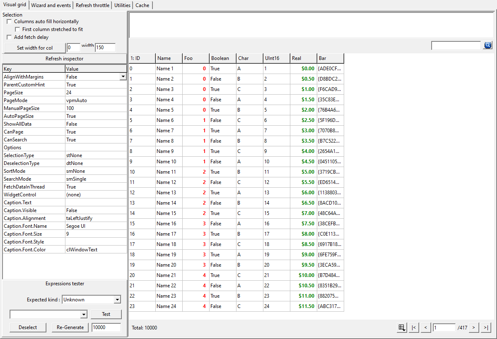
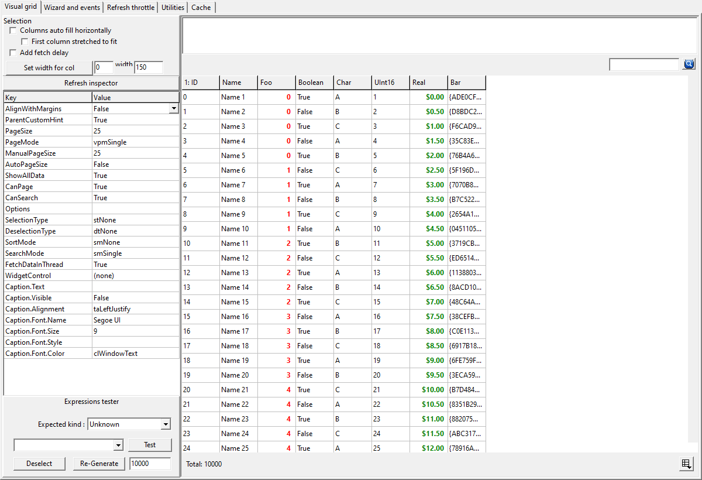
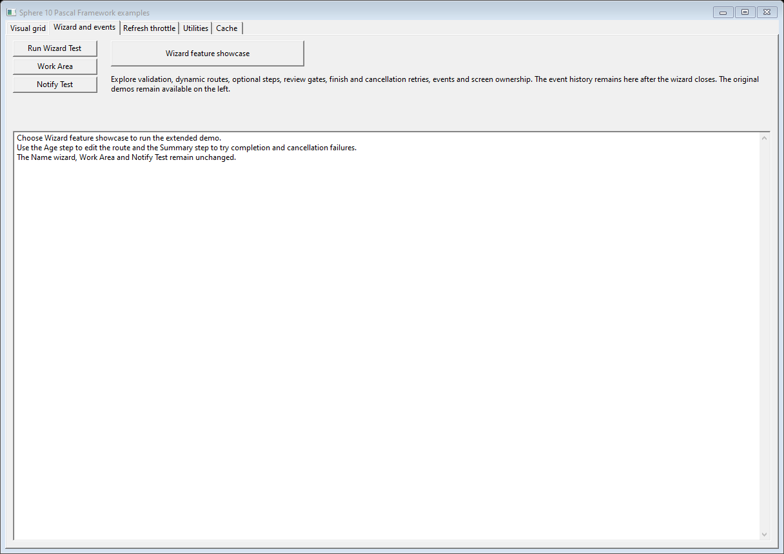
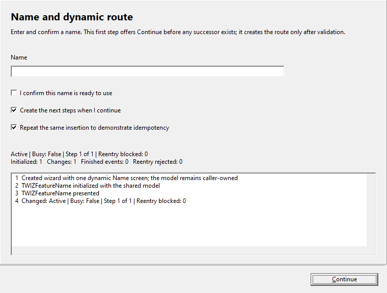
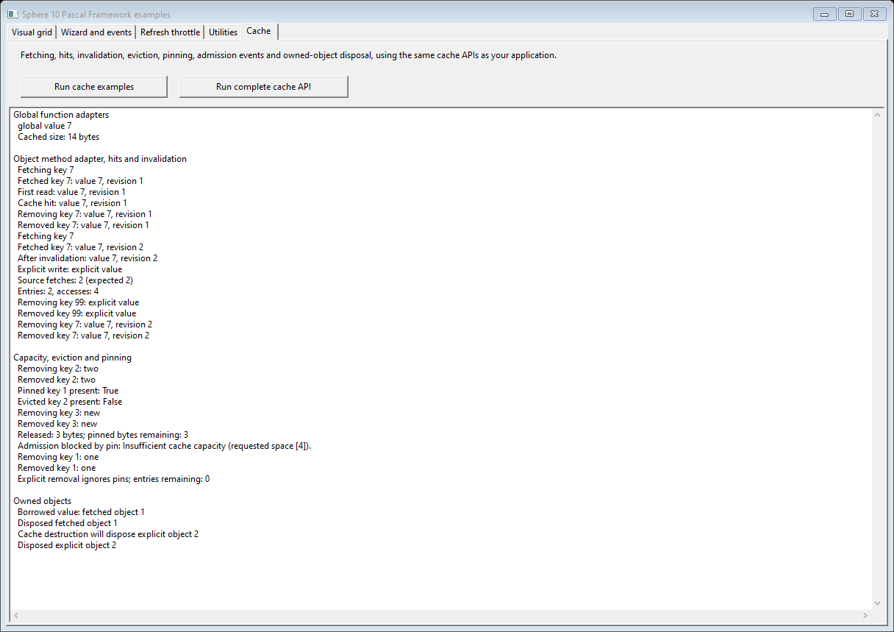

# Sphere 10 Pascal Framework demo

One application demonstrates the framework in Delphi and Lazarus, with generated
local data and no wallet, node, database or network.

Open [Sphere10PascalFramework.dproj](../../Sphere10PascalFramework.dproj) in Delphi
or [Sphere10PascalFramework.lpi](../../Sphere10PascalFramework.lpi) in Lazarus.
Both build the same [entry point](../../Sphere10PascalFramework.dpr) and sources
without an installed package. Unit tests are [separate](../../tests/README.md).

Cache capacity rejection and simulated wizard failures raise handled exceptions.
If the debugger stops, choose Continue.

## Visual grid



[fMain.pas](fMain.pas) binds 10,000 generated records to eight columns and shows
custom drawing, the dollar renderer, selection callbacks and popup menus. Choose
**Single**, **Auto** or [**Manual**](../../resources/demo/unified-grid-manual.png)
paging with the footer's square button. In code:

```pascal
grid.ManualPageSize := 25;
grid.PageMode := vpmAuto; // vpmSingle shows all rows; vpmManual restores 25.
```



Lazarus LCL screenshots:
[Auto](../../resources/demo/unified-grid-auto-fpc.png),
[Manual](../../resources/demo/unified-grid-manual-fpc.png),
[Single](../../resources/demo/unified-grid-single-fpc.png).

Try search, sorting, selection, column sizing, captions, fonts and toolbar
widgets in the property editor. **Add fetch delay** simulates slow work.

## Wizard and events



Choose **Wizard feature showcase**:

1. Enter and confirm a name.
2. Enter an age. Inject, replace or remove optional notes, then go Back and
   change the route.
3. Accept the confirmation boundary, where Back is unavailable.
4. Try finish and cancel vetoes and simulated exceptions, then retry.
5. Inspect the event history, screen lifetimes and rejected recursive requests.

The [main README](../../README.md#wizards) shows the full flow.



- **Run Wizard Test** shows the property-bag action wizard.
- **Notify Test** shows multicast listeners and throttle modes.
- **Work Area** shows docked controls.

## Cache

**Run cache examples** ([UCacheDemo.pas](UCacheDemo.pas)) shows hits,
invalidation, writes, capacity and eviction, pins, lifecycle callbacks and object
ownership. The memo shows fetch counts and disposal outcomes.

**Run complete cache API** ([UCacheApiExamples.pas](UCacheApiExamples.pas)) adds
stale checks, callback adapters, metadata, bulk writes, bulk fetching and
preloaded dictionaries. The [main README](../../README.md#caching) explains their
contracts.



## Refresh throttle

Click **Notify** to try the five-second refresh throttle, as the
[timing walkthrough](../throttle/README.md) describes.

## Utilities

[**Run arrays and collections**](UArrayCollectionExamples.pas),
[**Run scoped disposal**](UDisposalReadmeExamples.pas),
[**Run core API examples**](UCoreApiExamples.pas) and
[**Run UI API examples**](UUiApiExamples.pas) report completion in the memo. All
except scoped disposal also check their results. The
[public type index](../../docs/public-api-examples.md) maps every public Framework
type to its recipe.

## Build layout

Delphi builds to `lib/Delphi/<platform>/demo/<configuration>` and Lazarus to
`lib/FPC/<cpu>-<os>/demo`. Delphi Community Edition builds through the IDE. The
[library packages](../../packages/README.md) are optional build targets.

The [SQLite adapter](sqlite/fMain.pas) is a source-only recipe for the older
optional mORMot integration.

Copyright © 2026 [Herman Schoenfeld](https://sphere10.com).
[MIT license](../../LICENSE).
