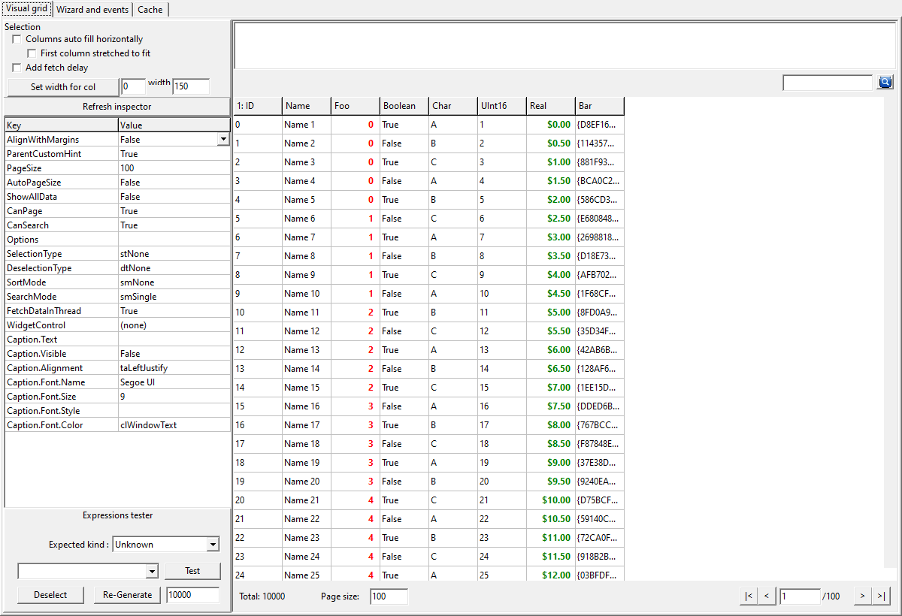
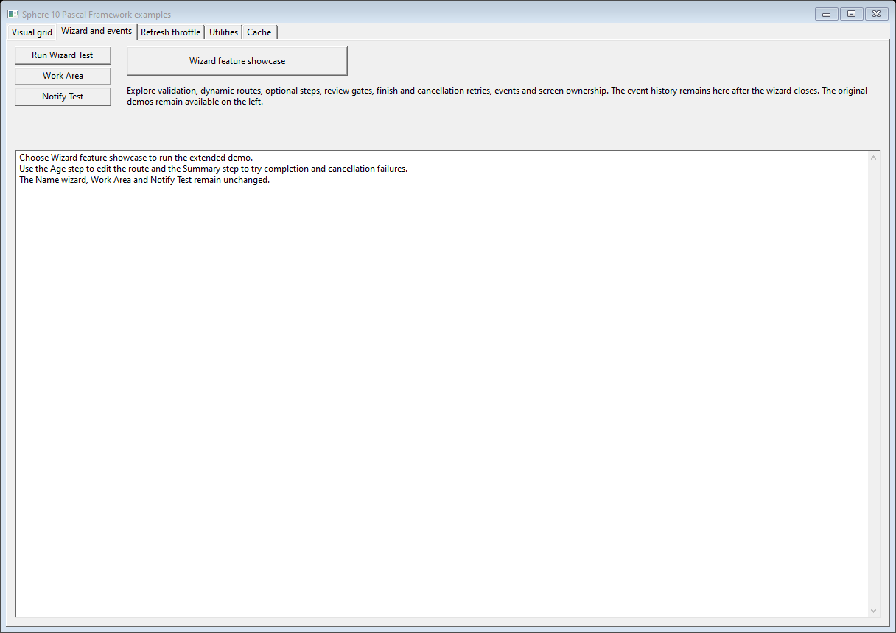
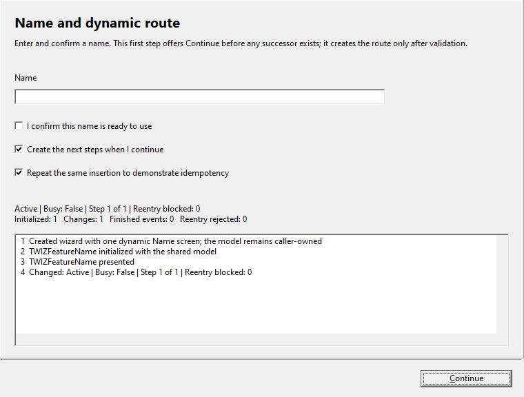
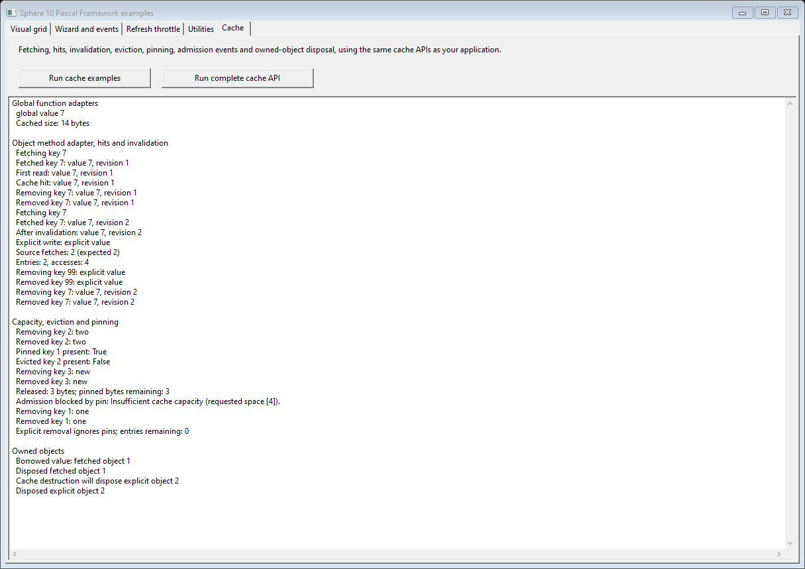

# Sphere 10 Pascal Framework demo

Open [Sphere10PascalFramework.dproj](../../Sphere10PascalFramework.dproj) in Delphi
or [Sphere10PascalFramework.lpi](../../Sphere10PascalFramework.lpi) in Lazarus.
Both run the same [entry point](../../Sphere10PascalFramework.dpr), Pascal sources
and paired `.dfm`/`.lfm` forms. No installed package is needed.

The app has **Visual grid**, **Wizard and events**, **Cache**, **Refresh throttle**
and **Utilities** tabs. Data is generated locally; no wallet, node, database or
network connection is involved. Automated unit tests remain [separate](../../tests/README.md).

## Visual grid

[fMain.pas](fMain.pas) binds 10,000 generated records to eight columns. Use the
property editor to try paging, automatic page sizes, search/sort, selection,
column sizing/stretching, captions, fonts and toolbar widgets. The Lazarus editor
uses RTTI; Delphi uses its native value-list editor.

The example also demonstrates custom cell rendering, the dollar renderer,
selection callbacks and popup menus. **Add fetch delay** simulates slow work.
The source captures data away from controls; completion publishes the page on
the main thread. Scoped disposal owns helper objects.

## Wizard and events

Choose **Wizard feature showcase**:

1. Enter and confirm a name. The first screen creates its route after validation.
2. Enter an age; inject, replace or remove optional notes. Go Back and change the route.
3. Accept the confirmation boundary, where Back is unavailable.
4. Try finish/cancel vetoes and simulated exceptions, then retry successfully.
5. Inspect the event history, screen lifetimes and rejected recursive requests.

The wizard uses one modal host at a stable position. It owns every screen,
including removed screens; the caller owns the shared model and retained history.
[Screen captures and usage code](../../README.md#wizards) show the full flow.

**Run Wizard Test** demonstrates the property-bag action wizard. **Notify Test**
shows multicast listeners and throttle modes. **Work Area** shows docked controls.

## Cache

**Run cache examples** demonstrates fetch hits, invalidation, explicit writes,
capacity/eviction, pins, lifecycle callbacks and object ownership. Its memo shows
fetch counts and disposal outcomes. [UCacheDemo.pas](UCacheDemo.pas) contains the code.

**Run complete cache API** adds subclassed stale detection, every callback adapter,
entry metadata, explicit bulk writes, bulk-fetch caching and borrowed
preloaded dictionaries. [UCacheApiExamples.pas](UCacheApiExamples.pas) contains the
worked recipes; the [main README](../../README.md#caching) explains their contracts.

Capacity rejection and simulated wizard failures deliberately raise handled
exceptions. A debugger can stop at the first-chance exception; Continue runs the
example's recovery path.

## Refresh throttle

Click **Notify** to request a real grid refresh. Repeated clicks restart the
five-second quiet period; the counters distinguish requests, deliveries and
provider calls. The card follows the throttle's waiting state.
[Step-by-step timing check](../throttle/README.md).

## Utilities

| Button | Worked examples |
| --- | --- |
| Arrays and collections | All array methods/overloads, list operations, comparers, predicates and transformation adapters. |
| Scoped disposal | Several objects and memory blocks, class-owned disposal bags and explicit ownership transfer. |
| Core API | Results, dates, statistics, files, Variants, notifications, TScope cleanup, automatic read/write/upgradeable scopes, explicit locking, data sources, search expressions and common visuals. |
| UI API | Column callbacks, selection, VCL compatibility controls and a model-bound wizard lifecycle. |

Each runner checks its results and appends completion to the memo. The
[public type index](../../docs/public-api-examples.md) maps every public Framework
type to its recipe, with platform-specific and empty APIs marked explicitly.

## Build layout

Delphi outputs go under `lib/Delphi/<platform>/demo/<configuration>`; Lazarus
outputs go under `lib/FPC/<cpu>-<os>/demo`. Delphi Community Edition builds through
the IDE. Optional [library packages](../../packages/README.md) are reusable build
targets rather than additional runnable demos.

The preserved [SQLite adapter](sqlite/fMain.pas) is a source recipe for the older
optional mORMot integration. It has no separate application project and is not
needed by this demo.

Copyright © 2026 [Herman Schoenfeld](https://sphere10.com).
[MIT license](../../LICENSE).
