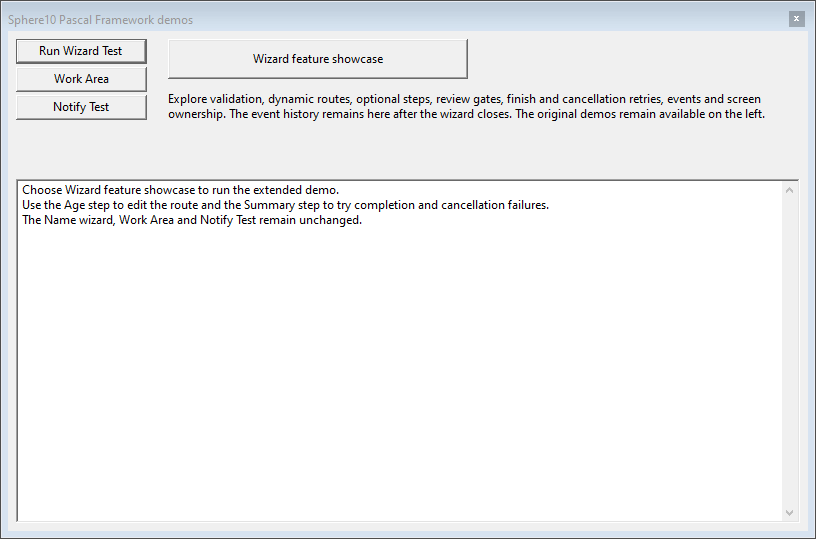

# Wizard example

Open `FrameworkTester.lpi` in Lazarus, build it and choose **Wizard feature
showcase** for the extended demonstration. The original **Run Wizard Test**,
Work Area and Notify Test buttons remain available.



## Feature showcase walkthrough

1. Enter and confirm a name. Leave **Create the next steps when I continue**
   unchecked to see a missing dynamic successor remain retryable. Re-enable it
   and continue. Repeated insertion demonstrates idempotency.
2. Enter a nonnegative whole-number age; zero is valid. On this screen, try each
   route action to inject, replace or remove the optional notes step and verify
   that mutating a copied path leaves the live path intact. Back returns to the
   earlier choice, restoring its saved route.
3. Include optional notes, visit that step, then return to Age and remove it.
   Its form remains owned until wizard disposal; initialization and destruction
   counters expose this lifetime.
4. Accept the confirmation boundary. Previous is unavailable on this screen;
   the final Summary can return to it.
5. On Summary, select **Veto first attempt** or **Raise first attempt** for
   finishing or cancellation. The first attempt remains active, and the next
   attempt succeeds. Toggle **Allow cancellation** to exercise the permission
   guard. Recursive requests are deliberately attempted inside callbacks and
   recorded as rejected while the wizard is busy.

The launcher retains the event history and final model after the modal window
closes. It records initialized/destroyed screens and accepted Finished events.

### Name and dynamic successors


### Age and route editing


### Optional notes


### Confirmation boundary


### Completion, cancellation and retry


These screenshots come from the actual native LCL forms, rendered by an
isolated validation process without sending desktop mouse or keyboard input.

## Original name wizard

Choose **Run Wizard Test** from the main window. Enter a name, select a branch and check the required checkbox
before choosing Next. Previous returns to the earlier branch choice; the next
navigation rebuilds that continuation. The finish callback rejects the name
`fail`. The cancellation callback permits closing only from the first screen.

The example uses the existing `TActionWizard<TGenericWizardBag>.Show` API in
`UFRMMain.pas`. The caller creates and frees the property bag around the modal
call. The wizard owns all its screen forms, including screens injected by
`UWIZName_Step1.pas` and screens later removed from the active path.

## Screen lifecycle and navigation

Derive screens from `TWizardForm<TModel>` and use their protected `Model`
property. `Initialize` now runs after `Start` assigns the model. It runs once
for each screen type, including screens first introduced by a branch. Use
`OnPresent` to refresh displayed values on each visit.

`Validate(out message)` runs before `OnNext`. Return false with a message to
keep the current screen open. Commit accepted input and update the branch in
`OnNext`; `UpdatePath` remains usable from that callback. The example uses both
`ptInject` and `ptReplaceAllNext`.

For a workflow that initially registers only its choice screen, set its traits
in `Initialize`:

```pascal
Traits := [wstAssumeHasNext];
```

The host displays Next while the screen creates its successor in `OnNext`.
If no successor is supplied, navigation reports a rejection and the wizard
stays active. Repeating an identical contiguous injection does not duplicate
the continuation. `ptRemoveNext` removes selected future screen types;
`RemoveScreen` removes a type from the path without transferring ownership.

## Completion and cancellation

`TActionWizard` takes object-method callbacks for finishing and cancellation.
Returning false leaves the wizard open, with the supplied message available to
the caller. An exception also leaves its workflow state active for retry.
Successful completion and cancellation are terminal and do not repeat their
callbacks. Set `IsCancellable` to false to reject cancellation before invoking
the cancellation callback; its permission is checked again after that callback.

Custom hosts and automated callers can use `TryNext`, `TryPrevious`, `Finish`
and `Cancel`, which return a Boolean and an output message instead of displaying
a rejection dialog. Active operations require `Start` to have supplied a model.
`State`, `IsBusy`, `CurrentScreenIndex` and the copied `Screens` array expose
workflow state. `ChangedEvent` and `FinishedEvent` use `UCommon`'s multicast
notification helpers.

The [FPCUnit suite](../../tests/README.md) covers navigation and failure paths
without interactive modal dialogs.
